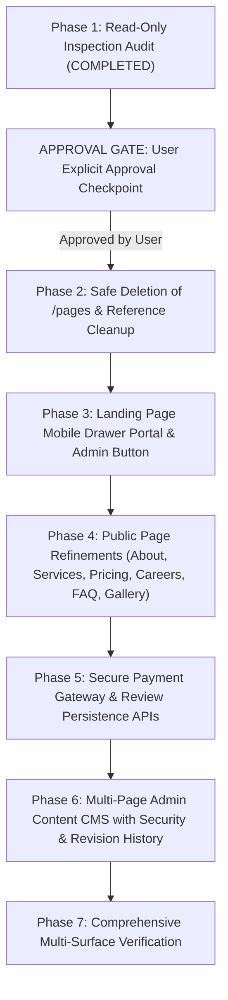

# SERVICEPRO OS - MASTER IMPLEMENTATION SPECIFICATION & REFACTORING PLAN

**Project:** ServicePro OS (Contractor Operations & Field Service Platform)  
**Date:** October 30, 2026  
**Status:** **FROZEN MASTER SPECIFICATION & INSPECTION AUDIT REPORT**

---

> [!IMPORTANT]
> ## MANDATORY PRE-IMPLEMENTATION APPROVAL GATE
> **Before editing, modifying, creating, or deleting ANY project code files:**
> 1. **Phase 1: Read-Only Inspection:** Conduct a comprehensive read-only inspection of the entire existing project without altering any code.
> 2. **Approval Gate Checkpoint:** Present the complete inspection report detailing affected files, deletion lists, preserved features, dependencies, security protocols, and execution sequence, and wait for explicit user approval.
> 3. **STRICT GOVERNANCE RULE:**  
>    **Do NOT create, modify, delete, rename, overwrite, or restructure any project code files until explicit approval is received from the user.**

---

## 1. GLOBAL DATA CLEANUP, CONDITIONAL VISIBILITY & PORTAL REQUIREMENTS

### A. Always Preserved (100% Unchanged)
- Complete existing website layout, branding, and visual design.
- Global headers, responsive navigation bars, and desktop/mobile footers.
- All CTA cards, CTA sections, action buttons, and marketing banners.
- All feature descriptions, technical architecture pillars, and category guides.
- All forms, input fields, interactive modals, and booking wizards (never hide data-entry mechanisms).
- All existing CSS, Tailwind styling, glassmorphism effects, and responsive breakpoints.

### B. Prohibited Demo Data to Remove
- Fabricated customers (`cust-1004`, fake names like David, Elena, etc.).
- Fabricated jobs (`#1004`, `#1003`, fake work order lines).
- Fabricated invoices (`INV-1004`, fake line items).
- Fabricated payment transactions and mock card credentials.
- Fabricated notifications (*"Technician arrived at your address"*).
- Fabricated technician profiles (`tech-carlos`, `tech-marcus`, `tech-elena`).
- Fabricated customer reviews, star testimonials, and mock owner replies.

### C. Protected Exceptions (DO NOT REMOVE)
1. **Landing Page (`/`)**:  
   Preserve only the explicitly protected Landing Page showcase demonstrations, workflow builders, telemetry metrics, and feature cards. Do not restore, retain, or introduce fabricated customer, job, invoice, payment, technician, notification, or review records in other sections.
2. **Gallery Page (`/gallery`)**:  
   Preserve existing demo before/after posts and demo video reels as specified until explicit future removal instruction is given.

### D. Explicit Three-Portal Inspection & Cleanup Requirements
Inspection and cleanup must cover all three system portals:
1. **Admin Portal (`src/app/(admin)/admin/...`):**
   - Preserve all dashboards, dispatch boards, calendar views, customer tables, invoice tables, job management screens, and navigation menus.
   - Remove all hardcoded dummy customer profiles, jobs, line items, and synthetic transaction records.
   - Source all tables and metrics strictly from genuine backend data stores.
2. **Technician Portal (`src/app/(tech)/tech/...`):**
   - Preserve technician schedule, active job views, estimate builders, profile editors, and earnings screens.
   - Clear hardcoded technician defaults (`"Carlos Mendez"`, `"Van #104"`).
   - Display active assigned work only when genuine dispatch assignments exist.
3. **Customer Portal (`src/app/account/...`):**
   - Preserve appointment history, invoice lookup, vehicle tracking screens, and profile managers.
   - Clear mock customer names (`"Maria Rivera"`), fake appointments, and synthetic invoices.
   - Display appointments and payment receipts only when genuine customer bookings exist.

### E. Consistent Empty-State & Conditional Visibility Rules
1. **Hide Empty Data Grids & Tables:** When `data.length === 0`, do not render empty table skeletons or blank grids.
2. **Designed Empty-State Cards:** Where an empty-state design exists (e.g. Reviews, Technicians, Appointments, Invoices), display the clean designed empty-state card informing the user and providing an action CTA.
3. **Always Keep CTA Sections Visible:** Surrounding CTA sections, banners, and help cards must never be hidden when data is empty.
4. **Never Display Fake Records:** Zero synthetic dummy records in empty states.
5. **Never Hide Data-Entry Forms:** Forms, creation buttons, and booking wizards must always remain available so users can add real records.
6. **State Discrimination:** Cleanly distinguish between `loading` (spinner/skeleton), `error` (retry alert), and `empty` (`data.length === 0`).
7. **Permanent Component Integrity:** Never delete component code or JSX structures merely because their data source is currently empty.

---

## 2. TECHNICIANS PAGE IMPLEMENTATION SPECIFICATION (`/technicians`)

1. **Remove Fabricated Profiles:** Purge all synthetic technician profiles (`PUBLIC_TECHS`) and fake real-time availability states.
2. **Preserve Page Layout & Structure:** Retain the page header, EPA/background check badges banner, responsive card grid layout, and booking CTAs.
3. **Designed Empty State:** When no genuine technician profiles exist in the database, display the designed fleet standby card:
   - Headline: *"Certified Field Specialists Staged Across All Metro Zones"*
   - Message: *"Our emergency response fleet is currently on active rotation. Book service online to have the nearest certified master technician dispatched immediately to your address."*
   - CTA Action Button: *"Book Service Online →"* linking to `/book`.
4. **Display Genuine Records Only:** When genuine technician profiles are retrieved from the database, render them automatically within the preserved card grid.
5. **Certification Integrity:** Never display or claim EPA Section 608 or NATE certifications or service-area coverage for individuals without verified database credential records.

---

## 3. DASHBOARD METRIC CARDS & DATA INTEGRITY SPECIFICATION

For all dashboard metric and KPI cards across Admin, Tech, and Customer portals:
1. **Preserve Card Design & Layout:** Maintain visual design, iconography, trend indicators, and layout styling.
2. **Zero Fabricated Numbers:** Never hardcode dummy revenue numbers (e.g. `$142,500`), fake profit percentages, or synthetic job counts.
3. **Neutral Zero State:** When genuine database records are unavailable or empty, display a clean, neutral zero state (`$0.00`, `0`, `0%`).
4. **Calculated from Genuine Records:** Metrics must be computed dynamically from actual database queries or ledger stores.
5. **No Error Confusion:** An empty dataset must display neutral zero metrics, never an error state or broken graph.

---

## 4. REVIEW SUBMISSION PERSISTENCE & VERIFICATION GOVERNANCE

For the Customer Reviews system (`/reviews` and review components):
1. **Backend API Persistence:** Reviews submitted via the "Leave a Review" modal must post to `/api/reviews` and persist in database/ledger storage.
2. **Server-Side Validation:** All submissions must be validated server-side (rating between 1–5, non-empty customer name, verified service tag, sanitization of review text against stored XSS).
3. **Moderation Status Flag:** Submitted reviews receive a verification status (`pending_moderation` vs `verified_customer`).
4. **Database Retrieval:** The review feed dynamically fetches persisted reviews from `/api/reviews`.
5. **Anti-Tampering:** Prevent client-side manipulation of review ratings or verified badges.
6. **Graceful Fallback:** If zero reviews are present in the database, display the designed empty state: *"No reviews yet. Be the first verified customer to share your experience!"* with the "Write a Review" CTA.

---

## 5. PAYMENT GATEWAY SECURITY & COMPLIANCE SPECIFICATIONS

For `/pay/[token]`, `/pay`, and checkout payment flows:
1. **Provider-Backed Multi-Method Architecture:**
   - Card payments (Visa, MasterCard, Amex via Stripe Elements).
   - UPI / VPA (Format-validated VPA handles `@okhdfcbank`, `@okaxis`, etc.).
   - Dynamic QR Code (Auto-generated high-contrast QR session for mobile scan & pay).
   - PhonePe / Google Pay / Wallets (Direct intent & wallet integration).
   - Netbanking (Bank selector for top retail and commercial institutions).
2. **Zero Credential Storage:** Never store raw card numbers, CVVs, or sensitive credentials in the application database.
3. **Server-Side Secret Isolation:** Keep payment provider API keys, webhook signing secrets, and merchant tokens strictly on the server; never expose them to frontend bundles.
4. **Server-Side Transaction Verification:** Payment confirmation must be validated server-side via `/api/pay/verify` (verifying provider transaction amount, currency, reference ID, and final status) before marking an invoice `paid`.
5. **Idempotency & Duplicate Protection:** All payment authorization requests must supply unique idempotency keys (`idempotency_key = pay_tok + attempt_id`) to prevent double-charges on network retries or multiple clicks.
6. **Webhook Signature Verification & Out-of-Order Handling:** Webhook endpoints (`/api/webhooks/*`) must enforce cryptographic signature verification (HMAC / Stripe signature) and handle retries and out-of-order events safely.
7. **Factual Compliance Claims:** Do not display claims such as "256-bit SSL" or "PCI-DSS compliant" unless factually verified and the applicable security requirements have actually been met. Maintain the compact 1-line compliance footer on desktop, hidden on mobile.

---

## 6. ADMIN CONTENT CMS SECURITY & REVISION GOVERNANCE (`/admin/content`)

The Admin Content CMS provides centralized management for all non-user website details:
1. **Multi-Page Content Registry:**
   - Home Landing Page (`/`)
   - Payment Prices & Diagnostic Rates (`/pricing`, `/pay`)
   - Contractor SaaS Plans (`/subscribe`)
   - Privacy Policy (`/privacy`)
   - Terms of Service (`/terms`)
   - Refund Policy (`/refund-policy`)
   - Security & Compliance (`/security`)
   - Accessibility Statement (`/accessibility`)
   - About Us (`/about`)
   - Careers & Vacancies (`/careers`)
   - Contact Center (`/contact`)
   - FAQ Knowledge Base (`/faq`)
   - Service Areas (`/service-areas`)
   - HVAC Services (`/services`)
2. **Role-Based Server-Side Access Control:**
   - Only authenticated Admin users with verified admin roles can access CMS editing, saving, and publishing.
   - Enforce permission checks server-side in API handlers, not merely by hiding frontend UI controls.
3. **Content Sanitization & Stored XSS Protection:**
   - Strictly validate and sanitize all saved text, markup, and URLs server-side before persisting.
   - Prevent stored XSS injection and unauthorized script execution.
4. **Draft vs. Live Publishing Workflow:**
   - Changes can be saved as "Draft" without altering the public live site.
   - Explicit confirmation dialog required before triggering "Publish Live".
5. **Audit Trail & Revision History:**
   - Maintain an immutable revision log capturing timestamp, admin identity/role, and modified field keys.
   - 1-click "Restore Previous Version" (rollback) functionality.
   - Concurrency protection to prevent accidental overwriting of newer revisions.
6. **Owner Confirmation for Business Information:**
   - Specific prices ($129 Diagnostic, $169 Emergency, $99 Tune-Up, 7% Tax, $49/$129/$299 SaaS plans), refund guarantees, hotline details, and compliance statements are treated as configurable values requiring business owner confirmation—never fabricated or published as unverified legal/commercial facts.

---

## 7. SAFEGUARDED DELETION OF THE UNNECESSARY `/pages` DIRECTORY PAGE

1. **Delete the directory file:** Remove `src/app/(public)/pages/page.tsx`.
2. **Delete the folder:** Remove `src/app/(public)/pages/` and any directory-specific components not imported elsewhere.
3. **Remove route links:** Remove references to `/pages` from `src/app/account/layout.tsx`, `src/components/brand/BrandTagline.tsx`, `src/components/layout/Navbar.tsx`, and `src/components/shared/AuthLockBanner.tsx`.
4. **Preserve ALL individual website pages:** Every individual page (`/`, `/about`, `/services`, `/how-it-works`, `/pricing`, `/subscribe`, `/careers`, `/apply`, `/contact`, `/faq`, `/gallery`, `/reviews`, `/technicians`, `/service-areas/*`, `/services/*`, `/account/*`, `/tech/*`, `/admin/*`, `/login`, etc.) remains **100% active, untouched, and fully functioning at its original URL**.
5. **No replacement directory:** Do not create any replacement directory or sitemap card index.
6. **Build verification:** The Next.js project must compile with zero broken imports or route errors after deletion.

---

## 8. REVISED SEVEN-PHASE EXECUTION SEQUENCE WITH APPROVAL CHECKPOINT

1. **Phase 1: Read-Only Project Inspection (COMPLETED)**  
   Inspect the entire project and prepare the file-by-file audit report. Zero code files modified.
2. **Approval Gate Checkpoint (CURRENT STAGE)**  
   Present affected files, deletion list, preserved features, dependencies, risks, and implementation sequence. Do not proceed without explicit approval.
3. **Phase 2: Safe `/pages` Deletion**  
   Permanently delete `src/app/(public)/pages/`, clean referencing files, and verify all individual routes continue functioning at original URLs.
4. **Phase 3: Landing Page Mobile Drawer Portal & Admin Shortcut**  
   Implement `createPortal` mobile drawer with solid `#0C1523` background and add the accessible "Edit Page Details" button.  
   *Instruction:* Preserve only the explicitly protected Landing Page showcase demonstrations and Gallery demo content. Do not restore, retain, or introduce fabricated customer, job, invoice, payment, technician, notification, or review records in other sections.
5. **Phase 4: Public Page Refinements**  
   - Restore About page CTA background image (`public/images/final-cta-house.jpg`) with dark gradient overlay.
   - Update Services page CTA buttons to dynamic dispatches and add worker avatar image support.
   - Clarify Pricing (service flat rates) vs. Subscription (contractor SaaS fleet plans).
   - Add "Apply for Job" buttons to Careers vacancies; add clear service booking vs trade applicant notice on Apply page.
   - Implement FAQ sticky sidebar with isolated category display.
   - Build Instagram-style Gallery (Posts & Video Reels tabs), preserving existing demo content.
6. **Phase 5: Secure Payment Gateway & Review Persistence**  
   - Implement multi-method payment options (UPI, QR, Netbanking, PhonePe/Wallets, Cards) with server verification, secret isolation, and idempotency protection.
   - Implement review submission backend persistence (`/api/reviews`), server-side validation, moderation flags, and dynamic feed updates.
   - Set `PUBLIC_TECHS = []` on `/technicians` and render fleet standby card with booking CTA.
   - Clean fabricated records across Admin, Tech, and Customer portals with neutral zero states for empty metrics.
7. **Phase 6: Multi-Page Admin Content CMS with Security & Revision History**  
   Build the comprehensive `/admin/content` editor with full 14-page registry, server-side access control, stored XSS sanitization, Save Draft / Publish Live, revision history, rollback, and owner confirmation guidelines.
8. **Phase 7: Comprehensive Multi-Surface Verification**  
   Test all 14 CMS registry entries, all affected public pages, all three portals (Admin, Tech, Customer), all payment flows, review submission and retrieval, and every preserved route with full TypeScript compilation and Next.js build verification.
