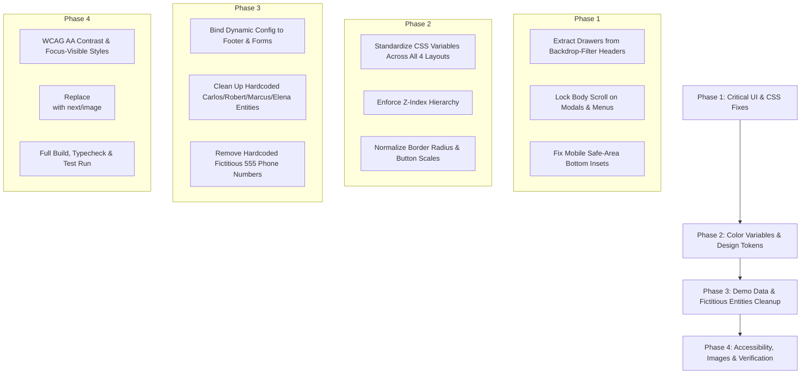

# SERVICEPRO OS — COMPREHENSIVE UI, CSS & DEMO DATA AUDIT REPORT

**Date:** October 30, 2026  
**Project:** ServicePro OS (Next.js 14 App Router, TypeScript Strict, Tailwind CSS v3.4.12)  
**Status:** Audit Completed — **NO CODE CHANGES MADE** (Awaiting User Review & Approval)

---

## 1. EXECUTIVE SUMMARY & RE-AUDIT OF CLINE'S REPORT

A thorough re-check of the codebase was conducted to verify the claims in Cline's previous report. **The user's skepticism was completely justified.** Cline's report was found to be incomplete, missed critical frontend breaking bugs, hallucinated file contents, and severely underreported hardcoded demo data across the application.

### Major Discrepancies in Cline's Report:
1. **Hallucinated Route Content**: Cline claimed `src/app/demo/page.tsx` contained 5 tab sections, simulated video players, and ROI calculation displays. **In reality, `src/app/(public)/demo/page.tsx` is a 5-line redirect file** (`redirect("/admin")`). Those interactive sections actually reside inside `src/app/(public)/page.tsx` (the main landing page).
2. **Severely Underreported Hardcoded Data**:
   - **Carlos Mendez**: Cline reported 8 files. The actual codebase contains **88 occurrences across 35 files**.
   - **Other Technicians & Customers**: Cline completely omitted **Robert Caldwell** (27 occurrences), **Marcus Vance** (23 occurrences), **Elena Rivera** (10 occurrences), and **Maria Rivera** (15 occurrences).
   - **Vehicle Numbers**: Cline reported only "Van #104". The codebase also contains **Van #102**, **Van #108**, **Van #105**, and **Mobile Tech Van #04**.
   - **Fictitious Phone Numbers**: Cline noted 2 files. In reality, **over 75 occurrences** of `(305) 555-01xx` numbers exist, including hardcoded phone numbers in `Footer.tsx` that bypass `businessConfig.phone`.
3. **Missed the Critical Frontend Mobile UI Bug**: Cline completely missed the `backdrop-filter` containing-block bug on `<header>` that caused the mobile slide-out drawer to break and float transparent unstyled text directly over the hero section on real mobile devices.

---

## 2. COMPREHENSIVE FRONTEND UI & CSS ISSUES (12 CATEGORIES)

### Category 1: Mobile Drawer & Sticky Header Containing Block Trap (CRITICAL)
- **Problem**: When a parent element (`<header>`) has `backdrop-filter` (`backdrop-blur-md`), modern CSS specifications dictate that it creates a new containing block for all `position: fixed` children.
- **Affected Files**:
  - `src/app/(public)/page.tsx`
  - `src/components/layout/Navbar.tsx`
- **Impact**: On mobile phones, fixed drawers and backdrops collapse inside the 80px header, causing menu links to spill out without backgrounds directly over hero text, while backdrops fail to dim the screen.
- **Remediation**: Render mobile drawers and backdrops outside the `<header>` element with solid `bg-[#0C1523]`, `z-[100]`, and full-screen height (`h-[100dvh]`).

### Category 2: Body Scroll Leakage During Open Menus & Modals
- **Problem**: Opening mobile menus or interactive modals on marketing and public pages does not lock `document.body.style.overflow = "hidden"`.
- **Affected Files**:
  - `src/app/(public)/page.tsx` (mobile menu, demo modal, trial modal)
  - `src/app/(public)/pricing/page.tsx` (enterprise modal)
  - `src/app/(public)/pay/[token]/page.tsx` (payment success modal)
- **Impact**: Background content scrolls and bounces awkwardly under open drawers on touchscreens.

### Category 3: Color Token Fragmentation & Bypassed Brand Configuration
- **Problem**: `globals.css` and `RootLayout` define CSS variables (`--navy-950`, `--navy-900`, `--orange-500`, `--orange-600`), but 90%+ of components hardcode arbitrary hex values.
- **Hardcoded Hex Varieties**:
  - Backgrounds: `#060B14`, `#0C1523`, `#080E1A`, `#070D18`, `#0B132B`, `#0F172A`, `#020617`
  - Accents: `#F97316`, `#EA580C`, `#C2410C`, `#FFF7ED`
- **Affected Files**: Over 80 page files across `(admin)`, `(tech)`, `(public)`, and `account`.
- **Impact**: Changing primary brand colors in `config/business.config.ts` fails to rebrand the application because hex codes are hardcoded in the markup.

### Category 4: Contrast Ratio Failures (WCAG 2.1 AA Non-Compliance)
- **Problem**: `text-slate-500` (#64748B) and muted slate colors on ultra-dark backgrounds (#0C1523, #020617) yield contrast ratios of ~3.1:1 to ~3.8:1 (below the mandatory 4.5:1 minimum for regular text).
- **Affected Files**:
  - `src/app/(admin)/admin/audit-logs/page.tsx` (table subheaders, timestamps)
  - `src/app/(admin)/admin/reports/jobs/page.tsx` (legend labels)
  - `src/app/(public)/faq/page.tsx` (category subtitles and question meta)
  - `src/components/booking/steps/StepSlot.tsx` (unselected slot subtexts)
  - `src/components/booking/steps/StepDetails.tsx` (disclaimer fine print)
- **Remediation**: Upgrade muted text on dark surfaces to `text-slate-300` or `text-slate-400` with high-contrast text tokens.

### Category 5: Mobile Safe-Area Inset Gaps (`env(safe-area-inset-*)`)
- **Problem**: Sticky bottom action bars, drawers, and modal sheets omit `padding-bottom: env(safe-area-inset-bottom)`.
- **Affected Components**:
  - `src/app/(tech)/tech/jobs/[id]/page.tsx` (sticky bottom action bar: "Start Job", "Complete Checklist")
  - `src/app/book/page.tsx` & `src/components/booking/BookingWizard.tsx` (sticky bottom booking step controls)
  - `src/components/shared/AuthLockBanner.tsx` (bottom fixed notification bar)
- **Impact**: On iPhones and Android devices with gesture navigation, the bottom indicator bar overlaps CTA buttons, causing misclicks.

### Category 6: Arbitrary Border Radius Scaling
- **Problem**: `tailwind.config.ts` specifies semantic tokens:
  - `rounded-input` (10px)
  - `rounded-card` (14px)
  - `rounded-sheet` (20px)
  - `rounded-pill` (9999px)
- **Current Usage**: Pages arbitrarily mix `rounded-md`, `rounded-lg`, `rounded-xl`, `rounded-2xl`, and `rounded-full` across cards, inputs, and buttons on the same view.

### Category 7: Z-Index Stacking Inconsistencies
- **Problem**: No uniform z-index scale is enforced. Modals, flyouts, sticky headers, and toast notifications compete at `z-40` and `z-50`.
- **Observed Conflicts**:
  - Notifications flyout in admin layout vs modal overlays
  - Sonner Toaster (`z-50`) appearing behind modals (`z-50` with high DOM order)
- **Proposed Scale**:
  - Header: `z-40`
  - Dropdowns & Flyouts: `z-50`
  - Dim Backdrops: `z-[90]`
  - Slide Drawers & Modals: `z-[100]`
  - Toaster Notifications: `z-[110]`
  - Tooltips: `z-[120]`

### Category 8: Responsive Data Table Squishing (<768px Mobile)
- **Problem**: Admin tables contain 6–9 columns and lack horizontal scroll containers with visible swipe affordances.
- **Affected Routes**:
  - `src/app/(admin)/admin/invoices/page.tsx`
  - `src/app/(admin)/admin/payments/page.tsx`
  - `src/app/(admin)/admin/customers/page.tsx`
  - `src/app/(admin)/admin/payouts/page.tsx`
  - `src/app/(admin)/admin/inventory/transactions/page.tsx`
- **Impact**: Column text wraps heavily, dates overlap numbers, and action icons become nearly unclickable on phones.

### Category 9: Raw `` Tags Bypassing Next.js Image Optimization
- **Problem**: Over 60 raw HTML `` elements are used with `/* eslint-disable @next/next/no-img-element */` instead of `next/image`.
- **Affected Files**:
  - `src/app/(public)/page.tsx`
  - `src/app/(public)/about/page.tsx`
  - `src/app/(public)/gallery/page.tsx`
  - `src/app/(public)/technicians/page.tsx`
  - `src/components/layout/Navbar.tsx`
- **Impact**: No automatic WebP/AVIF generation, no responsive srcset generation, and no intrinsic width/height causing Cumulative Layout Shift (CLS).

### Category 10: Accessible Form Control Associations
- **Problem**: Multiple forms feature inputs without corresponding `id` attributes matching `<label htmlFor="...">`, or omit labels altogether in favor of placeholders.
- **Affected Files**:
  - `src/components/contact/ContactForm.tsx`
  - `src/app/(public)/pricing/page.tsx` (custom quote form)
  - `src/app/(public)/subscribe/checkout/page.tsx` (billing address form)
  - `src/app/(tech)/tech/profile/edit/page.tsx`
- **Impact**: Fails WCAG 3.3.2 (Labels or Instructions) and breaks automated browser autofill.

### Category 11: Touch Target Sizes Below 44x44px
- **Problem**: Pagination numbers, table quick actions, and filter pills measure 24px–32px tall.
- **Affected Files**:
  - `src/app/(admin)/admin/dispatch/board/page.tsx` (filter pills & zoom controls)
  - `src/app/(admin)/admin/jobs/page.tsx` (table row ellipsis menus)
  - `src/app/account/appointments/page.tsx` (date navigation chevron buttons)
- **Impact**: Fails WCAG 2.5.5 Target Size minimums on mobile devices.

### Category 12: `overflow-x: hidden` on `html, body` in `globals.css`
- **Problem**: `src/app/globals.css` sets `overflow-x: hidden` directly on `html, body`.
- **Impact**: In certain WebKit/Blink versions, this prevents proper scrolling of wide child containers and can alter sticky positioning behaviors.

---

## 3. COMPREHENSIVE DEMO DATA & ARTIFACT INVENTORY

### 3.1 Hardcoded Technicians & Workers (88+ references)
| Name | Role in Code | Real File Count | Specific File Examples |
|------|--------------|-----------------|------------------------|
| **Carlos Mendez** | Master HVAC Tech / Van #104 | **35 files (88 instances)** | `tech/profile/page.tsx`, `pay/page.tsx`, `admin/jobs/page.tsx`, `admin/dispatch/page.tsx`, `book/track/page.tsx`, `account/technicians/page.tsx` |
| **Robert Caldwell** | Senior Tech / Customer / Reviewer | **19 files (27 instances)** | `admin/customers/[id]/page.tsx`, `admin/invoices/page.tsx`, `admin/reports/technicians/page.tsx`, `admin/payments/page.tsx` |
| **Marcus Vance** | Commercial Chiller Specialist | **15 files (23 instances)** | `pay/page.tsx`, `gallery/page.tsx`, `reviews/page.tsx`, `tech/jobs/page.tsx`, `account/technicians/page.tsx` |
| **Elena Rivera** | Commercial Lead Mechanic | **8 files (10 instances)** | `pay/page.tsx`, `technicians/page.tsx`, `gallery/page.tsx`, `reviews/page.tsx`, `services-detail-data.ts` |
| **David Kim / Daniel Kim** | Field Tech / Customer | **9 files (14 instances)** | `admin/invoices/page.tsx`, `account/appointments/page.tsx`, `local-db-fallback.ts` |

### 3.2 Hardcoded Customers & Homeowners
| Name | Context | File Locations |
|------|---------|----------------|
| **Maria Rivera** | Default Client (#CL-90210) | `account/layout.tsx`, `account/profile/page.tsx`, `account/payments/page.tsx`, `pay/page.tsx`, `customer-portal.ts` |
| **David Chen** | Demo Customer | `demo-dataset.ts`, `account/appointments/page.tsx` |
| **Elena Rodriguez** | Demo Customer | `demo-dataset.ts`, `admin/jobs/page.tsx` |
| **Sofia Morales** | Demo Customer | `demo-dataset.ts`, `admin/dispatch/board/page.tsx` |
| **Hannah Sterling** | Demo Customer | `demo-dataset.ts`, `admin/customers/page.tsx` |
| **Trevor Jenkins** | Demo Customer | `demo-dataset.ts`, `admin/invoices/page.tsx` |

### 3.3 Fleet Van Identifiers
| Van Identifier | Files Present |
|----------------|---------------|
| **Van #104** | 8 files (`pay/page.tsx`, `technicians/page.tsx`, `tech/jobs/page.tsx`, `tech/leave/page.tsx`, `tech/profile/edit/page.tsx`, `book/track/page.tsx`, `WorkerProfileModal.tsx`, `services-detail-data.ts`) |
| **Van #102** | 3 files (`pay/page.tsx`, `technicians/page.tsx`, `services-detail-data.ts`) |
| **Van #108** | 3 files (`pay/page.tsx`, `technicians/page.tsx`, `services-detail-data.ts`) |
| **Van #105** | 1 file (`services-detail-data.ts`) |
| **Mobile Tech Van #04** | 2 files (`account/technicians/page.tsx`, `admin/jobs/[id]/page.tsx`) |

### 3.4 Hardcoded Fictitious Phone Numbers (`(305) 555-01xx`)
- **Over 75 occurrences** across the project.
- **Critical finding**: `src/components/layout/Footer.tsx` hardcodes `(305) 555-0100` on lines 83, 100, 129, 150, 166, and 192 instead of using `businessConfig.phone`.
- Hardcoded pre-filled phone state in `src/app/(public)/pricing/page.tsx:46` (`"(305) 555-0144"`).
- Hardcoded pre-filled phone state in `src/app/(public)/subscribe/checkout/page.tsx:96` (`"(305) 555-0144"`).
- Hardcoded pre-filled phone state in `src/app/account/profile/page.tsx:9` (`"(305) 555-0144"`).

### 3.5 Hardcoded Emails (`@example.com`)
- **Over 40 occurrences** across customer dossiers, invoice records, registration forms, and database seed fallbacks.
- Default fallback in `src/lib/supabase/middleware.ts:65`: sets cookie `sp_demo_customer_email = "maria.rivera@example.com"`.

### 3.6 Geographic Inconsistencies
- 249 references hardcoded to Miami, FL, Brickell, Coral Gables, etc.
- Direct inconsistency in `src/app/(public)/page.tsx:1686`: hardcodes `5.0 ★ (Austin, TX)` while all other content is Miami.

---

## 4. REMEDIATION STRATEGY & PHASED PLAN

---

## 5. AWAITING YOUR DECISION BEFORE PROCEEDING

As instructed: **No code has been edited.**

Please review the report above and select how you would like to proceed:
1. **Option A (Fix Critical UI & CSS First)**: Fix all broken mobile drawers, safe-area insets, body scroll locking, and contrast issues across layouts.
2. **Option B (Clean Up Hardcoded Demo Data & Phone Numbers First)**: Replace all hardcoded 555 numbers, van numbers, and fake technician/customer data with dynamic configuration.
3. **Option C (Comprehensive All-In-One Fix)**: Execute the full remediation roadmap in structured phases with verified test checks after each step.
4. **Option D (Custom Scope)**: Specify any specific files, pages, or issues you want prioritized first.
