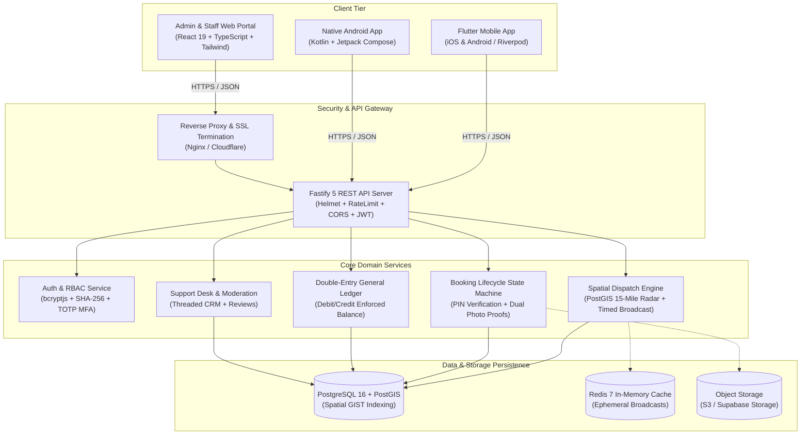

# ServicePro OS — Enterprise Technical Architecture Specification

> **Document Version**: 2.0.0 (Enterprise Rebuild Release)  
> **Target Audience**: Technical Due Diligence Teams, Lead Software Architects, Systems Integrators  
> **System Classification**: Multi-Tenant On-Demand Service Dispatch & General Ledger Platform  

---

## 1. System Topology & Component Boundaries



---

## 2. Database Domain Entity Model (20 Core Entities)

The database schema is partitioned into 6 structured migration scripts with exact rollback pairs:

1. **`001_tenants_and_auth.sql`**:
   - `tenants`: Multi-tenant boundary with unique subdomain, branding, currency, commission basis points (`default_platform_commission_bps`), and active flags.
   - `users`: Core authentication identity (`email`, `phone_number`, `password_hash`, `role`, `mfa_enabled`, `is_active`).
   - `user_sessions`: Refresh token rotation store with SHA-256 token hashing, client IP, and device fingerprints.
   - `user_mfa_credentials`: RFC 6238 TOTP secrets and recovery codes.
   - `permissions` & `role_permissions`: Granular operation-level RBAC matrix.

2. **`002_profiles_and_entities.sql`**:
   - `admin_profiles` & `staff_profiles`: Operator metadata, assigned territory, permissions.
   - `customer_profiles`: Default billing address, courtesy credit, Stripe customer identifier.
   - `provider_profiles`: Trade licenses, vehicle details, hourly rate, Stripe Connect Express payout account.
   - `provider_locations`: PostGIS `GEOGRAPHY(Point, 4326)` with GIST spatial index for real-time fleet radar search.
   - `provider_shifts`: Working shift schedules by day of week.
   - `customer_addresses`: Geocoded customer service locations with PostGIS spatial indexing.

3. **`003_services_and_catalog.sql`**:
   - `service_categories`: Active trade verticals (Plumbing, Electrical, HVAC, etc.) with SVG icons and banners.
   - `services`: Base pricing, estimated durations, emergency priority multipliers.
   - `service_pricing_tiers`: Standard, Urgent, and Emergency multiplier schedules.

4. **`004_bookings_and_dispatch.sql`**:
   - `bookings`: State machine controlling lifecycle (`REQUESTED` -> `BROADCASTING` -> `ASSIGNED` -> `EN_ROUTE` -> `ON_SITE` -> `COMPLETED`).
   - `dispatch_broadcasts`: 60-second timed dispatch offers to nearby technicians with transactional race-condition lock.
   - `booking_timeline_events`: Immutable audit trail for every status transition.
   - `work_order_proofs`: Before/after photographic evidence, diagnostic checklist, and customer cryptographic signature.

5. **`005_finance_and_ledger.sql`**:
   - `invoices`: Itemized financial breakdown (`labor_subtotal_cents`, `parts_subtotal_cents`, `tax_total_cents`, `discount_cents`).
   - `invoice_items`: Line item audit rows.
   - `payment_transactions`: Stripe pre-authorization hold and capture records with unique idempotency keys.
   - `webhook_events`: Inbound webhook idempotency tracking.
   - `ledger_accounts`: 5-category chart of accounts (`ASSET`, `LIABILITY`, `EQUITY`, `REVENUE`, `EXPENSE`).
   - `ledger_entries`: Strict double-entry journal requiring different debit and credit accounts.
   - `provider_payouts`: Stripe Connect transfer tracking.

6. **`006_support_crm_and_audit.sql`**:
   - `support_tickets`: Customer support inquiry tickets with priority levels.
   - `ticket_messages`: Real-time conversation thread records.
   - `customer_reviews`: 1–5 star ratings, comments, and admin moderation flags.
   - `notification_logs`: Delivery tracking for email and SMS notifications.
   - `audit_logs`: Immutable security audit log tracking administrative modifications.
   - `tenant_cms_configs`: Dynamic white-label branding, hero banner copy, and promo coupons.
   - `installer_provision_logs`: Tamper-proof log sealing the `/installer` provisioning endpoint after initial deployment.

---

## 3. Financial Engine & Double-Entry Accounting Architecture

To eliminate rounding leakage, ServicePro OS enforces integer cent calculations (`BIGINT`) across all financial tables.

### Transaction Posting Lifecycle

```
Customer Pre-Auth ($150.00):
   Debit:   1010 Operating Bank Account (Asset)        +$150.00
   Credit:  2010 Customer Escrow Liability (Liability) +$150.00

Job Completion (15% Platform Commission = $22.50, Technician Payout = $127.50):
   Debit:   2010 Customer Escrow Liability (Liability) -$150.00
   Credit:  4010 Platform Commission Revenue (Revenue) +$22.50
   Credit:  2020 Technician Payable (Liability)        +$127.50

Technician Payout via Stripe Connect:
   Debit:   2020 Technician Payable (Liability)        -$127.50
   Credit:  1010 Operating Bank Account (Asset)        -$127.50
```

---

## 4. Security & Compliance Architecture

- **OWASP ASVS v4.0.3 Alignment**:
  - Passwords hashed using `bcrypt` (work factor 10).
  - Access tokens expire in 15 minutes; refresh tokens use SHA-256 storage and one-time rotation.
  - RFC 6238 TOTP Multi-Factor Authentication.
  - Strict input validation using Zod schemas on all Fastify endpoints.
  - Cross-Tenant data isolation enforced at the database query level with `tenant_id` context binding.
