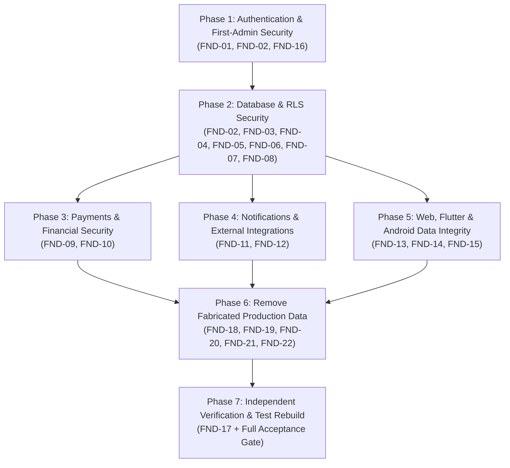

# SERVICEPRO OS — CONTROLLED 7-PHASE REMEDIATION PLAN (`FND-01` – `FND-22`)

**Baseline Audit Preserved**: [`audit_report/POST_REMEDIATION_INDEPENDENT_VERIFICATION.md`](file:///c:/Users/hashm/OneDrive/Desktop/Online%20work/audit_report/POST_REMEDIATION_INDEPENDENT_VERIFICATION.md) (`0` modifications made to baseline report or application source code)  
**Date**: November 15, 2026  
**Scope**: All 22 findings (`7` Critical, `11` High, `4` Medium) from the Post-Remediation Independent Verification Report  
**Strict Architectural Mandate**: **Do not redesign the application, remove pages, restructure folders, replace the technology stack, or simplify existing features.** Remediate all identified defects while preserving the 52 Web pages (`38` Admin + `14` Staff), 22 Flutter screens, 18 Android screens, UI layouts, navigation, role-based panels, and integrations.

---

## 1. Phase Dependency & Execution Order Matrix



| Phase | Name | Findings Covered | Severity Breakdown | Prerequisite Phases |
| :---: | :--- | :--- | :--- | :--- |
| **Phase 1** | Authentication & First-Admin Security | `FND-01`, `FND-02` (Auth/Bootstrap), `FND-16` | 3 Critical | Baseline Report Preserved |
| **Phase 2** | Database & RLS Security | `FND-02` (Tenant RLS), `FND-03`, `FND-04`, `FND-05`, `FND-06`, `FND-07`, `FND-08` | 2 Critical, 4 High, 1 Medium | Phase 1 (`users` & `tenants` bootstrap) |
| **Phase 3** | Payments & Financial Security | `FND-09`, `FND-10` | 1 Critical, 1 High | Phase 2 (`bookings` & `payments` schema/RLS) |
| **Phase 4** | Notifications & External Integrations | `FND-11`, `FND-12` | 1 Critical, 1 High | Phase 1 & Phase 2 (`users` role & `audit_logs`) |
| **Phase 5** | Web, Flutter & Android Data Integrity | `FND-13`, `FND-14`, `FND-15` | 3 High | Phase 1 & Phase 2 (RLS & RPC contracts) |
| **Phase 6** | Remove Fabricated Production Data | `FND-18`, `FND-19`, `FND-20`, `FND-21`, `FND-22` | 3 High, 2 Medium | Phases 3, 4 & 5 (Live data wiring) |
| **Phase 7** | Independent Verification & Test Suite Rebuild | `FND-17` + All 10 Acceptance Criteria | 1 Medium + Full Gate | Phases 1 – 6 Complete |

---

## 2. Detailed Phase-by-Phase Remediation Specification

### PHASE 1 — Authentication and First-Admin Security (`FND-01`, `FND-02`, `FND-16`)

#### Findings Addressed
- **`FND-01` (CRITICAL)**: Public privilege escalation in [`03_security_rbac_and_rls.sql:318-327`](file:///c:/Users/hashm/OneDrive/Desktop/Online%20work/supabase/migrations/03_security_rbac_and_rls.sql#L318-L327) where `NOT EXISTS (SELECT 1 FROM public.users u WHERE u.role = 'ADMIN')` runs under caller RLS, evaluating to `TRUE` for all non-admin users and allowing any authenticated user to self-insert `role = 'ADMIN'`.
- **`FND-02` (CRITICAL — First-Admin Provisioning)**: [`supabaseClient.ts:138-159`](file:///c:/Users/hashm/OneDrive/Desktop/Online%20work/admin_web/src/services/supabaseClient.ts#L138-L159) (`signUp`) only writes `user_metadata` and never creates the initial `public.tenants` or `public.users` row, leaving the first Admin as `'ANONYMOUS'` in [`current_user_role()`](file:///c:/Users/hashm/OneDrive/Desktop/Online%20work/supabase/migrations/03_security_rbac_and_rls.sql#L42-L67) and blocked by circular RLS on `public.tenants`.
- **`FND-16` (CRITICAL)**: [`LoginPage.tsx:38-41, 67, 127-200`](file:///c:/Users/hashm/OneDrive/Desktop/Online%20work/admin_web/src/pages/auth/LoginPage.tsx#L38-L200) and [`AdminContext.tsx:1048-1141`](file:///c:/Users/hashm/OneDrive/Desktop/Online%20work/admin_web/src/context/AdminContext.tsx#L1048-L1141) determine `isFirstTimeDeployment` via browser `localStorage`, hardcode `mfaSecret = 'JBSWY3DPEHPK3PXP'`, accept `'123456'`, `'000000'`, or any 8-character string as an MFA bypass, allow Staff login with any email + 6-character password without checking any user table, and log users in locally even when `supabaseService.signIn()` fails.

#### Exact Files & Symbols to Modify
1. [`supabase/migrations/03_security_rbac_and_rls.sql`](file:///c:/Users/hashm/OneDrive/Desktop/Online%20work/supabase/migrations/03_security_rbac_and_rls.sql):
   - Replace policy `"Self registration for customer or first-boot admin"` (`L318-L327`) with a strict customer-only self-registration policy:
     ```sql
     CREATE POLICY "Self registration for customer only"
     ON public.users FOR INSERT
     WITH CHECK (
         id = public.current_auth_uid()
         AND role = 'CUSTOMER'
         AND is_active = TRUE
     );
     ```
   - Add a `SECURITY DEFINER` RPC `public.check_system_initialized()` (`SET search_path = public`) that returns `BOOLEAN` (`EXISTS (SELECT 1 FROM public.users WHERE role = 'ADMIN' AND is_active = TRUE)`) so unauthenticated clients can check whether initial bootstrap is complete without exposing `public.users` rows.
   - Add a `SECURITY DEFINER` function `public.bootstrap_first_admin(p_company_name TEXT, p_full_name TEXT, p_setup_token_hash TEXT)` or dedicated Edge Function [`supabase/functions/bootstrap-first-admin/index.ts`](file:///c:/Users/hashm/OneDrive/Desktop/Online%20work/supabase/functions) using `SUPABASE_SERVICE_ROLE_KEY` + server-side `INITIAL_ADMIN_SETUP_TOKEN` secret + PostgreSQL advisory lock (`pg_advisory_xact_lock(9048101)`) that:
     1. Verifies zero `ADMIN` rows exist in `public.users`.
     2. Verifies the caller's one-time server provisioning token (`INITIAL_ADMIN_SETUP_TOKEN`) or server CLI invocation.
     3. Atomically creates the primary row in `public.tenants`, inserts the `ADMIN` row in `public.users`, sets `auth.users.raw_app_meta_data = jsonb_build_object('role', 'ADMIN', 'tenant_id', v_tenant_id)`, and generates a per-user cryptographic TOTP secret in `public.user_mfa_credentials`.
2. [`admin_web/src/services/supabaseClient.ts`](file:///c:/Users/hashm/OneDrive/Desktop/Online%20work/admin_web/src/services/supabaseClient.ts):
   - Add `checkSystemInitialized()`, `provisionFirstAdmin()`, and `fetchAuthenticatedUserProfile()` that reads the caller's authoritative `role`, `tenant_id`, and `is_active` from `public.users`.
   - Update `signIn()` (`L115-L136`) to return `{ user, session, profile, error }` and never swallow authentication errors.
3. [`admin_web/src/pages/auth/LoginPage.tsx`](file:///c:/Users/hashm/OneDrive/Desktop/Online%20work/admin_web/src/pages/auth/LoginPage.tsx):
   - Remove hardcoded `const [mfaSecret] = useState('JBSWY3DPEHPK3PXP')` (`L67`), remove the `'123456'` / `'000000'` MFA backdoor (`L197-L199`), and remove the `cleanCode.length >= 8` unverified backup code bypass (`L193-L195`).
   - Query `supabaseService.checkSystemInitialized()` on mount rather than relying solely on `localStorage.getItem('servicepro_admin_initialized')`.
   - Require `await login(...)` to await server verification before transitioning to MFA or dashboard state; require Staff login (`L168-L181`) to authenticate against `supabaseService.signIn()` and verify an active `STAFF` record (`is_active = TRUE`).
4. [`admin_web/src/context/AdminContext.tsx`](file:///c:/Users/hashm/OneDrive/Desktop/Online%20work/admin_web/src/context/AdminContext.tsx):
   - Convert `login` (`L1083-L1141`) and `setupMasterAdmin` (`L1048-L1081`) to `async` functions returning `Promise<{ success: boolean; role?: UserRole; error?: string }>`.
   - When Supabase is configured, require `await supabaseService.signIn(email, password)` to succeed and enforce the server-returned `role` from `public.users` rather than trusting the client dropdown `role`.

#### Dependencies & Risks
- **Dependencies**: Must be executed first so `public.users` and `public.tenants` have a valid, secure bootstrap path.
- **Risks**: Existing browser test scripts (`verify_all_49_pages_production.cjs`) inject `localStorage` state; local offline development mode must only be active when `supabaseService.isConfigured()` is `false` (and clearly labeled as unconfigured local mode) while still enforcing real password hash, staff roster lookup, and real TOTP verification without `'123456'`/`'000000'` bypasses.

#### Verification Tests
- Verify `03_security_rbac_and_rls.sql` contains zero `NOT EXISTS (SELECT 1 FROM public.users ...)` expressions in non-`SECURITY DEFINER` policies.
- Verify `LoginPage.tsx` rejects `'123456'`, `'000000'`, arbitrary 8-character strings, and unregistered Staff emails.
- Verify `supabaseService.signIn()` failure blocks login completely.

---

### PHASE 2 — Database and RLS Security (`FND-02`, `FND-03`, `FND-04`, `FND-05`, `FND-06`, `FND-07`, `FND-08`)

#### Findings Addressed
- **`FND-02` (CRITICAL — Cross-Tenant RLS Leaks)**:
  - 14 policies in [`03_security_rbac_and_rls.sql`](file:///c:/Users/hashm/OneDrive/Desktop/Online%20work/supabase/migrations/03_security_rbac_and_rls.sql) include `OR public.current_tenant_id() IS NULL`, allowing any Admin/Staff user with a `NULL` `tenant_id` to read/modify all tenants' records.
  - 8 tables (`customer_profiles`, `provider_profiles`, `service_categories`, `services`, `booking_parts`, `job_evidence`, `user_mfa_credentials`, `security_audit_logs`) omit tenant isolation in their RLS policies.
- **`FND-03` (HIGH)**: `"Users update own basic profile"` (`L311-L315`) only checks `role = (SELECT u.role ...)`, allowing any user to update their own `tenant_id` or `is_active`.
- **`FND-04` (CRITICAL)**:
  - Technicians have `FOR ALL` on `provider_profiles` (`L354-L357`), allowing self-verification (`is_verified = TRUE`, `average_rating = 5.0`, `completed_jobs_count = 9999`, `stripe_connect_id`).
  - Customers have `FOR ALL` on `customer_profiles` (`L338-L341`), allowing self-editing of `tier = 'ENTERPRISE'` and `lifetime_spend_cents`.
  - Customers and Technicians have unrestricted column `UPDATE` on `bookings` (`L415-L425`), allowing manipulation of `total_amount_cents`, `escrow_status`, `platform_fee_cents`, `provider_payout_cents`, and `safety_pin`.
  - Unassigned technicians cannot accept broadcast jobs (`provider_id IS NULL`) because `"Technicians update assigned bookings"` requires `provider_id = public.current_auth_uid()`.
  - Customers have `FOR ALL` on `booking_parts` (`L446-L454`), allowing them to delete parts or set `unit_cost_cents = 0`.
  - Users have `FOR ALL` on `user_mfa_credentials` (`L622-L625`), allowing reset of `failed_attempts` and `locked_until`.
- **`FND-05` (HIGH)**: `find_nearest_technicians` and `get_nearby_technicians` ([`02_postgis_functions.sql:6-87`](file:///c:/Users/hashm/OneDrive/Desktop/Online%20work/supabase/migrations/02_postgis_functions.sql#L6-L87)) are `SECURITY DEFINER` with no `tenant_id` filter and are executable by `anon`.
- **`FND-06` (HIGH)**: `verify_arrival_geofence` ([`02_postgis_functions.sql:137-171`](file:///c:/Users/hashm/OneDrive/Desktop/Online%20work/supabase/migrations/02_postgis_functions.sql#L137-L171)) is `SECURITY DEFINER` without verifying `provider_id = public.current_auth_uid()`.
- **`FND-07` (CRITICAL)**: Technicians can read `safety_pin` directly via `SELECT * FROM public.bookings` under `"Technicians view assigned or broadcast bookings"` (`L401-L407`), and `release_escrow_to_technician` ([`02_postgis_functions.sql:174-217`](file:///c:/Users/hashm/OneDrive/Desktop/Online%20work/supabase/migrations/02_postgis_functions.sql#L174-L217)) does not verify `public.current_user_role() = 'ADMIN'` when allowing non-assigned callers.
- **`FND-08` (MEDIUM)**: `security_audit_logs` `INSERT` policy (`L640-L647`) blocks unauthenticated `LOGIN_FAILED` events while allowing authenticated users to spoof `actor_email` and `role`.

#### Exact Files & Symbols to Modify
1. [`supabase/migrations/01_initial_schema.sql`](file:///c:/Users/hashm/OneDrive/Desktop/Online%20work/supabase/migrations/01_initial_schema.sql) & [`supabase/migrations/03_security_rbac_and_rls.sql`](file:///c:/Users/hashm/OneDrive/Desktop/Online%20work/supabase/migrations/03_security_rbac_and_rls.sql):
   - Remove every occurrence of `OR public.current_tenant_id() IS NULL` across all policies in `03_security_rbac_and_rls.sql`.
   - Enforce tenant scoping via `tenant_id = public.current_tenant_id()` (or parent join to `public.users` / `public.bookings` / `public.service_categories`) on all 8 previously unscoped tables (`customer_profiles`, `provider_profiles`, `service_categories`, `services`, `booking_parts`, `job_evidence`, `user_mfa_credentials`, `security_audit_logs`).
   - Tighten `"Users update own basic profile"` (`L311-L315`) `WITH CHECK` to lock `role`, `tenant_id`, and `is_active`:
     ```sql
     WITH CHECK (
         id = public.current_auth_uid()
         AND role = (SELECT u.role FROM public.users u WHERE u.id = public.current_auth_uid())
         AND tenant_id IS NOT DISTINCT FROM (SELECT u.tenant_id FROM public.users u WHERE u.id = public.current_auth_uid())
         AND is_active = (SELECT u.is_active FROM public.users u WHERE u.id = public.current_auth_uid())
     );
     ```
   - Add a `BEFORE UPDATE` trigger `public.enforce_column_level_security()` on `provider_profiles`, `customer_profiles`, `bookings`, and `booking_parts`:
     - On `provider_profiles`: non-`ADMIN`/`STAFF` callers cannot modify `is_verified`, `background_check_passed`, `average_rating`, `total_reviews_count`, or `completed_jobs_count`.
     - On `customer_profiles`: non-`ADMIN`/`STAFF` callers cannot modify `tier` or `lifetime_spend_cents`.
     - On `bookings`: non-`ADMIN`/`STAFF` callers cannot modify `subtotal_cents`, `tax_cents`, `platform_fee_cents`, `provider_payout_cents`, `total_amount_cents`, `escrow_status`, `payment_intent_id`, `safety_pin`, `customer_id`, or `tenant_id`. Customers can only cancel (`status = 'CANCELLED'`) when `status IN ('REQUESTED', 'ASSIGNED')`.
     - On `booking_parts`: Customers can only `UPDATE` `approved_by_customer = TRUE` on rows belonging to their booking (no customer `INSERT`/`DELETE` or `unit_cost_cents`/`quantity` mutation).
   - Replace `"Users manage own MFA credentials"` (`FOR ALL`) with `SELECT`-only for the owner (`user_id = public.current_auth_uid()`) and manage MFA enrollment/verification via `SECURITY DEFINER` RPCs so clients cannot clear `locked_until` or `failed_attempts`.
   - Protect `bookings.safety_pin` from Technician read access by revoking direct `SELECT (safety_pin)` from non-customer/non-admin roles or moving `safety_pin` verification exclusively inside `release_escrow_to_technician` / customer-only RPC so technicians querying `bookings` never receive the customer's `safety_pin`.
   - Add `SECURITY DEFINER` RPC `public.accept_broadcast_booking(p_booking_id UUID)` (`SET search_path = public`) that verifies the caller is an active, verified `TECHNICIAN` in the same `tenant_id`, atomically claims a booking where `status = 'REQUESTED'` and `provider_id IS NULL`, sets `provider_id = public.current_auth_uid()` and `status = 'ASSIGNED'`, and writes an `audit_logs` entry.
   - Replace direct client `INSERT` on `security_audit_logs` with a rate-limited `SECURITY DEFINER` RPC `public.log_security_event(p_event_type TEXT, p_severity TEXT, p_details TEXT, p_attempted_email TEXT DEFAULT NULL)` that derives `actor_email` and `role` from `public.users` when authenticated and labels unauthenticated events as `role = 'ANONYMOUS'`.
2. [`supabase/migrations/02_postgis_functions.sql`](file:///c:/Users/hashm/OneDrive/Desktop/Online%20work/supabase/migrations/02_postgis_functions.sql):
   - Add `SET search_path = public, extensions` to all `SECURITY DEFINER` functions (`find_nearest_technicians`, `get_nearby_technicians`, `calculate_booking_financials`, `verify_arrival_geofence`, `release_escrow_to_technician`, `sync_technician_geography`).
   - In `find_nearest_technicians` and `get_nearby_technicians`: require `public.current_auth_uid() IS NOT NULL`, filter `u.tenant_id = public.current_tenant_id()`, and `REVOKE EXECUTE ... FROM PUBLIC, anon; GRANT EXECUTE ... TO authenticated;`.
   - In `verify_arrival_geofence`: verify `v_booking.provider_id = public.current_auth_uid() OR public.current_user_role() IN ('ADMIN', 'STAFF')` and `v_booking.tenant_id = public.current_tenant_id()` before updating `status = 'ARRIVED'`.
   - In `release_escrow_to_technician`: fix the authorization condition (`L190`) to:
     ```sql
     IF v_booking.provider_id IS DISTINCT FROM public.current_auth_uid()
        AND public.current_user_role() <> 'ADMIN' THEN
         RAISE EXCEPTION 'Unauthorized: Only the assigned technician or an administrator can complete this booking.';
     END IF;
     ```
     and verify `v_booking.tenant_id = public.current_tenant_id()`.

#### Dependencies & Risks
- **Dependencies**: Requires Phase 1 (`current_user_role()` and `current_tenant_id()`).
- **Risks**: [`scripts/validate_migrations.cjs`](file:///c:/Users/hashm/OneDrive/Desktop/Online%20work/scripts/validate_migrations.cjs) checks table and policy counts; ensure all 19 tables remain RLS-enabled and update validator assertions to verify both policy presence and absence of `OR public.current_tenant_id() IS NULL`.

#### Verification Tests
- Run `npm run verify-env` and verify 0 syntax errors, balanced delimiters, 19/19 tables with RLS enabled, and 0 cross-tenant `IS NULL` bypasses.

---

### PHASE 3 — Payments and Financial Security (`FND-09`, `FND-10`)

#### Findings Addressed
- **`FND-09` (CRITICAL)**: [`supabase/functions/stripe-payment-intent/index.ts:52-128`](file:///c:/Users/hashm/OneDrive/Desktop/Online%20work/supabase/functions/stripe-payment-intent/index.ts#L52-L128) trusts client-supplied `amountCents` and `providerConnectAccountId`, calls Stripe *before* checking `public.bookings`, miscalculates the 15% fee on the gross total (including tax/parts) instead of labor subtotal, and omits a Stripe `Idempotency-Key`.
- **`FND-10` (HIGH)**: [`supabase/functions/stripe-webhook/index.ts:18-135`](file:///c:/Users/hashm/OneDrive/Desktop/Online%20work/supabase/functions/stripe-webhook/index.ts#L18-L135) only checks a single `v1` signature value, has no `event.id` idempotency table, prematurely sets `escrow_status = 'RELEASED_TO_PROVIDER'` on `payment_intent.succeeded` before job completion/PIN verification, fails to look up `booking_id` from `public.payments` on `charge.refunded` and `charge.dispute.created`, and ignores `payment_intent.payment_failed` / `payment_intent.canceled`.

#### Exact Files & Symbols to Modify
1. [`supabase/migrations/01_initial_schema.sql`](file:///c:/Users/hashm/OneDrive/Desktop/Online%20work/supabase/migrations/01_initial_schema.sql) & [`supabase/migrations/03_security_rbac_and_rls.sql`](file:///c:/Users/hashm/OneDrive/Desktop/Online%20work/supabase/migrations/03_security_rbac_and_rls.sql):
   - Add a `stripe_webhook_events` idempotency tracking table (or `webhook_event_id TEXT UNIQUE` on `payments` / `audit_logs`) with RLS enabled (`ADMIN` read-only, service_role write) to prevent replay processing of duplicate Stripe `event.id` deliveries.
2. [`supabase/functions/stripe-payment-intent/index.ts`](file:///c:/Users/hashm/OneDrive/Desktop/Online%20work/supabase/functions/stripe-payment-intent/index.ts):
   - Accept only `{ bookingId }` from the request body (ignore any client-sent `amountCents` or `providerConnectAccountId`).
   - Query `public.bookings` (and approved `public.booking_parts` + `public.provider_profiles`) **before** calling Stripe.
   - Verify `bookingRow` exists and `bookingRow.customer_id === userData.user.id` (or caller has `role === 'ADMIN'` in the same `tenant_id`).
   - Compute `total_amount_cents`, `platform_fee_cents`, and `provider_payout_cents` server-side using `calculate_booking_financials` (`subtotal_cents`, approved parts sum, `tax_rate`, `platform_fee_percent`), and read `stripe_connect_id` exclusively from `public.provider_profiles` for `bookingRow.provider_id`.
   - Pass `Idempotency-Key: pi_booking_${bookingId}_${bookingRow.total_amount_cents}` in the Stripe API request headers.
3. [`supabase/functions/stripe-webhook/index.ts`](file:///c:/Users/hashm/OneDrive/Desktop/Online%20work/supabase/functions/stripe-webhook/index.ts):
   - Parse all `v1=...` signature entries from `Stripe-Signature` and return `true` if any valid `v1` signature matches `timingSafeEqualHex` (supporting Stripe webhook secret rollovers).
   - Record `event.id` atomically before processing; if `event.id` was already processed, return `200 OK` (`{ received: true, duplicate: true }`).
   - Resolve `bookingId` from `obj.metadata?.booking_id`, and if absent (e.g., `charge.refunded`, `charge.dispute.created`), query `public.payments` by `gateway_payment_intent_id = paymentIntentId` to obtain `booking_id`.
   - On `payment_intent.succeeded`: update `payments.status = 'CAPTURED'` and keep `bookings.escrow_status = 'HELD_IN_ESCROW'` unless `bookings.status === 'COMPLETED'` (preventing premature escrow release before job & PIN completion).
   - Handle `payment_intent.payment_failed` and `payment_intent.canceled` by setting `payments.status = 'FAILED'` and `bookings.escrow_status = 'PENDING_DEPOSIT'`.

#### Dependencies & Risks
- **Dependencies**: Requires Phase 2 financial column rules on `public.bookings` and `public.payments`.
- **Risks**: Web and mobile callers that currently pass `amountCents` in the request payload will still work seamlessly if extra client fields are ignored while `bookingId` is required.

#### Verification Tests
- Verify `stripe-payment-intent/index.ts` queries `public.bookings` and `public.provider_profiles` before `fetch('https://api.stripe.com/v1/payment_intents')`.
- Verify `stripe-webhook/index.ts` handles `payment_intent.amount_capturable_updated`, `payment_intent.succeeded`, `payment_intent.payment_failed`, `payment_intent.canceled`, `charge.refunded`, and `charge.dispute.created` with `event.id` deduplication.

---

### PHASE 4 — Notifications and External Integrations (`FND-11`, `FND-12`)

#### Findings Addressed
- **`FND-11` (HIGH)**: [`supabase/functions/twilio-sms/index.ts:44-100`](file:///c:/Users/hashm/OneDrive/Desktop/Online%20work/supabase/functions/twilio-sms/index.ts#L44-L100) allows any authenticated user (including `CUSTOMER`/`TECHNICIAN`) to send arbitrary SMS messages to any phone number, hardcodes `role: 'ADMIN'` and `ip_address: '127.0.0.1'` in `security_audit_logs`, and lacks E.164 validation or rate limiting.
- **`FND-12` (CRITICAL)**: [`supabase/functions/push-notification/index.ts:36-125`](file:///c:/Users/hashm/OneDrive/Desktop/Online%20work/supabase/functions/push-notification/index.ts#L36-L125) only checks `authHeader.startsWith('Bearer ')` without verifying the JWT, calls Google's decommissioned legacy FCM endpoint (`https://fcm.googleapis.com/fcm/send`), and returns HTTP `200` (`dispatched: true`) even when FCM or Resend returns `4xx`/`5xx`.

#### Exact Files & Symbols to Modify
1. [`supabase/functions/twilio-sms/index.ts`](file:///c:/Users/hashm/OneDrive/Desktop/Online%20work/supabase/functions/twilio-sms/index.ts):
   - Query `public.users` for `userData.user.id` and verify `userRow.is_active === true` and `userRow.role IN ('ADMIN', 'STAFF')` (returning HTTP `403 Forbidden` otherwise).
   - Validate `to` against strict E.164 format (`/^\+[1-9]\d{7,14}$/`) and enforce per-actor rate limiting (checking recent `TWILIO_SMS_SENT` events in `security_audit_logs` within the last 60 seconds).
   - Log the caller's actual `userRow.role`, actual request IP (`req.headers.get('x-forwarded-for')`), and `tenant_id` in `security_audit_logs`.
2. [`supabase/functions/push-notification/index.ts`](file:///c:/Users/hashm/OneDrive/Desktop/Online%20work/supabase/functions/push-notification/index.ts):
   - Initialize `supabaseAdmin = createClient(supabaseUrl, supabaseServiceKey)` and verify the caller's JWT via `await supabaseAdmin.auth.getUser(jwt)`.
   - Verify the caller's `public.users` record is active and authorized (`role IN ('ADMIN', 'STAFF')` or authorized booking participant for the target user within the same `tenant_id`).
   - Replace the decommissioned legacy `https://fcm.googleapis.com/fcm/send` call with **FCM HTTP v1 API** (`https://fcm.googleapis.com/v1/projects/${fcmProjectId}/messages:send`) using OAuth2 service account JWT assertion (`FCM_PROJECT_ID`, `FCM_CLIENT_EMAIL`, `FCM_PRIVATE_KEY` or `FCM_ACCESS_TOKEN`).
   - Check `fcmRes.ok` and `emailRes.ok`; if all requested channels fail, return HTTP `502 Bad Gateway` with `success: false` and upstream error details instead of `200 OK`.
   - Record an audit entry in `public.audit_logs` / `public.security_audit_logs`.

#### Dependencies & Risks
- **Dependencies**: Requires Phase 1 & Phase 2 `public.users` and `public.security_audit_logs` structures.
- **Risks**: Update `.env.example` and documentation to list `FCM_PROJECT_ID`, `FCM_CLIENT_EMAIL`, and `FCM_PRIVATE_KEY` for FCM HTTP v1.

#### Verification Tests
- Verify both `twilio-sms/index.ts` and `push-notification/index.ts` call `supabaseAdmin.auth.getUser(jwt)` and query `public.users` for role authorization.
- Verify `fcm.googleapis.com/fcm/send` no longer exists anywhere in the codebase.

---

### PHASE 5 — Web, Flutter, and Android Data Integrity (`FND-13`, `FND-14`, `FND-15`)

#### Findings Addressed
- **`FND-13` (HIGH)**: [`admin_web/src/services/supabaseClient.ts`](file:///c:/Users/hashm/OneDrive/Desktop/Online%20work/admin_web/src/services/supabaseClient.ts):
  - `saveBooking` (`L354-L426`) falls back to `.limit(1)` arbitrary customer/service rows when names do not match, overwrites `scheduled_start` with `new Date().toISOString()` on every status update, and generates a random UUID for `B-...` IDs without persisting it back to the caller.
  - `saveTechnician` (`L428-L483`) and `saveCategory` (`L510-L537`) generate random UUIDs for non-UUID IDs (`T-...`, `cat-...`), creating duplicate rows on repeated edits, and `saveTechnician` synthesizes fake `@servicepro.local` emails instead of preserving `tech.email`.
  - `verifyBookingEscrow` (`L581-L597`) filters `eq('booking_reference', bookingId)` when `bookingId` is a non-UUID (`B-101` vs `BK-101`) and omits `.select()`, returning `true` when `0` rows were updated.
- **`FND-14` (HIGH)**: Flutter [`booking_repository.dart`](file:///c:/Users/hashm/OneDrive/Desktop/Online%20work/serviceos/lib/data/repositories/booking_repository.dart) & [`supabase_remote_datasource.dart`](file:///c:/Users/hashm/OneDrive/Desktop/Online%20work/serviceos/lib/data/datasources/supabase_remote_datasource.dart):
  - `createBookingRequest` (`L166-L195`) and `approveExtraParts` (`L198-L205`) only mutate in-memory `_cache` and never call Supabase.
  - `completeWorkOrderWithSignature` (`L129-L148`) auto-reads `safetyPin` from `_cache` when `pinCode` is empty and falls back to `updateBookingStatus(bookingId, 'COMPLETED')` when `releaseEscrowToTechnician` returns `false`.
  - `uploadJobEvidence` (`L151-L163`) uploads to bucket `'job-evidence'` without inserting a `public.job_evidence` row, and `'job-evidence'` is not created in SQL migrations.
- **`FND-15` (HIGH)**: Android [`BookingRepository.kt`](file:///c:/Users/hashm/OneDrive/Desktop/Online%20work/serviceos_android/app/src/main/kotlin/com/serviceos/app/data/repository/BookingRepository.kt):
  - `configureSupabase()` is never called in [`MainActivity.kt`](file:///c:/Users/hashm/OneDrive/Desktop/Online%20work/serviceos_android/app/src/main/kotlin/com/serviceos/app/MainActivity.kt).
  - `syncFromSupabase()` and `releaseEscrowRemote()` send `Authorization: Bearer $anonKey` instead of an authenticated user JWT.
  - `syncFromSupabase()` overwrites `_bookings.value = remoteList` even when `remoteList` is empty, wiping offline bookings, and `addBooking()`/`updateStatus()` never `POST` or `PATCH` to Supabase.
  - Plaintext `SharedPreferences` stores `safetyPin` and tokens without encryption or thread synchronization.

#### Exact Files & Symbols to Modify
1. [`admin_web/src/services/supabaseClient.ts`](file:///c:/Users/hashm/OneDrive/Desktop/Online%20work/admin_web/src/services/supabaseClient.ts):
   - Add a deterministic UUID v5-style helper `toDeterministicUuid(namespace: string, id: string)` so any client ID (`B-...`, `T-...`, `cat-...`, `srv-...`) maps 1:1 to a stable UUID across saves.
   - In `saveBooking`: preserve existing `scheduled_start` when provided; never bind a booking to an unrelated `.limit(1)` customer or service; return `{ ok: boolean, id?: string }` after verifying `.select('id')` affected at least 1 row.
   - In `saveTechnician`: preserve `tech.email` when present and use deterministic UUIDs so updating a technician updates the same `users` and `provider_profiles` rows.
   - In `verifyBookingEscrow`: match by deterministic UUID or `booking_reference`, chain `.select('id')`, and return `Array.isArray(data) && data.length > 0`.
2. [`supabase/migrations/03_security_rbac_and_rls.sql`](file:///c:/Users/hashm/OneDrive/Desktop/Online%20work/supabase/migrations/03_security_rbac_and_rls.sql):
   - Provision the `'job-evidence'` bucket in `storage.buckets` (`INSERT INTO storage.buckets (id, name, public) VALUES ('job-evidence', 'job-evidence', false) ON CONFLICT (id) DO NOTHING;`) and add authenticated `storage.objects` RLS policies scoped to booking participants.
3. [`serviceos/lib/data/datasources/supabase_remote_datasource.dart`](file:///c:/Users/hashm/OneDrive/Desktop/Online%20work/serviceos/lib/data/datasources/supabase_remote_datasource.dart) & [`serviceos/lib/data/repositories/booking_repository.dart`](file:///c:/Users/hashm/OneDrive/Desktop/Online%20work/serviceos/lib/data/repositories/booking_repository.dart):
   - In `createBookingRequest`: when `_remote != null`, call `await _remote.createBooking(...)` with authenticated `customer_id`, `tenant_id`, `service_id`, `subtotal_cents`, `total_amount_cents`, `latitude`, `longitude`, and `service_address` before updating `_cache`.
   - In `approveExtraParts`: add `_remote.approveBookingParts(bookingId)` to update `booking_parts.approved_by_customer = true` in Supabase.
   - In `completeWorkOrderWithSignature`: require a non-empty, customer-provided 4-digit `pinCode` (`if (pinCode == null || pinCode.trim().length != 4) return null;`), never read `safetyPin` from `_cache`, and **remove** the fallback to `updateBookingStatus(bookingId, 'COMPLETED')` when `releaseEscrowToTechnician` returns `false`.
   - In `uploadJobEvidence`: after uploading to `storage.from('job-evidence')`, insert a metadata row into `public.job_evidence` (`booking_id`, `uploaded_by`, `evidence_type`, `file_url`).
4. [`serviceos_android/app/src/main/kotlin/com/serviceos/app/data/repository/BookingRepository.kt`](file:///c:/Users/hashm/OneDrive/Desktop/Online%20work/serviceos_android/app/src/main/kotlin/com/serviceos/app/data/repository/BookingRepository.kt) & [`MainActivity.kt`](file:///c:/Users/hashm/OneDrive/Desktop/Online%20work/serviceos_android/app/src/main/kotlin/com/serviceos/app/MainActivity.kt):
   - Initialize Supabase configuration from Android `BuildConfig` / system properties or setup config in `MainActivity.kt`, and support storing the authenticated user's session JWT (`setAuthSession(jwt, userId, tenantId)`).
   - Synchronize `_bookings` mutations (`@Synchronized` / `MutableStateFlow.update`), never persist `safetyPin` in plaintext preferences, upload local unsynced bookings via `POST /rest/v1/bookings` and status updates via `PATCH /rest/v1/bookings?id=eq.$id`, and merge remote bookings with unsynced local bookings instead of wiping local data when `remoteList` is empty.

#### Dependencies & Risks
- **Dependencies**: Requires Phase 2 RLS policies and storage bucket setup.
- **Risks**: Ensure [`scripts/validate_dart_codebase.cjs`](file:///c:/Users/hashm/OneDrive/Desktop/Online%20work/scripts/validate_dart_codebase.cjs) continues to pass across all 45 Dart files and 37 Kotlin files.

#### Verification Tests
- Run `npm run validate-mobile` and `npm run build` to verify TypeScript, Dart, and Kotlin structural/compile checks pass.

---

### PHASE 6 — Remove Fabricated Production Data (`FND-18`, `FND-19`, `FND-20`, `FND-21`, `FND-22`)

#### Findings Addressed
- **`FND-18` (HIGH)**: [`Page25TechnicianPerformance.tsx:34, 47, 74-105, 247`](file:///c:/Users/hashm/OneDrive/Desktop/Online%20work/admin_web/src/pages/module6/Page25TechnicianPerformance.tsx#L34-L247) displays hardcoded `Vikram Singh`, `Amit Sharma`, `Suresh Patel` fallback cards, `94.2%`, `4.88 ★`, `18m`, and fires a fake `addToast('Incentive bonus ($2,400 total) approved and queued for Stripe payout!', 'success')` toast when `technicians` is `[]`.
- **`FND-19` (HIGH)**: [`Page29TechnicianPayouts.tsx:59-68, 137`](file:///c:/Users/hashm/OneDrive/Desktop/Online%20work/admin_web/src/pages/module7/Page29TechnicianPayouts.tsx#L59-L137) hardcodes `$148,420.00` (`Disbursed This Month`) and toasts `'via Stripe Connect'` on local state changes; [`Page30RefundManagement.tsx:37-57, 111`](file:///c:/Users/hashm/OneDrive/Desktop/Online%20work/admin_web/src/pages/module7/Page30RefundManagement.tsx#L37-L111) hardcodes `14.2%` (`Historical Approval Rate`) and toasts `'via Stripe Gateway'` on local state changes.
- **`FND-20` (MEDIUM)**: [`customer_profile_screen.dart:141`](file:///c:/Users/hashm/OneDrive/Desktop/Online%20work/serviceos/lib/features/profile/presentation/screens/customer_profile_screen.dart#L141) displays a hardcoded Unsplash portrait (`https://images.unsplash.com/photo-1544005313-94ddf0286df2?w=200`) when no profile exists.
- **`FND-21` (MEDIUM)**: [`local_fixture_datasource.dart:14-123`](file:///c:/Users/hashm/OneDrive/Desktop/Online%20work/serviceos/lib/data/datasources/local_fixture_datasource.dart#L14-L123) and [`ServiceRepository.kt:7-108`](file:///c:/Users/hashm/OneDrive/Desktop/Online%20work/serviceos_android/app/src/main/kotlin/com/serviceos/app/data/repository/ServiceRepository.kt#L7-L108) contain pre-populated service catalogues and 2,218 fabricated review counts; [`demoDataLoader.ts`](file:///c:/Users/hashm/OneDrive/Desktop/Online%20work/admin_web/src/utils/demoDataLoader.ts) is accessible in the production TopNavbar (`Pitch Demo` button).
- **`FND-22` (HIGH)**: [`Page36PaymentNotificationConfig.tsx:157-201`](file:///c:/Users/hashm/OneDrive/Desktop/Online%20work/admin_web/src/pages/module8/Page36PaymentNotificationConfig.tsx#L157-L201) writes secret keys (`cfg_stripeSecretKey`, `cfg_twilioToken`, `cfg_fcmServerKey`, `cfg_awsAccessKey`, `cfg_stripeWebhookSecret`) into plaintext browser `localStorage`; [`SystemInstallerPage.tsx:76-99`](file:///c:/Users/hashm/OneDrive/Desktop/Online%20work/admin_web/src/pages/commercial/SystemInstallerPage.tsx#L76-L99) marks PostgreSQL, PostGIS, and Stripe webhooks `'VERIFIED'` using `setTimeout`.

#### Explicit Architectural Resolution for `FND-21` (Mobile Catalogues & Pitch Demo Mode)
1. **Mobile Service Catalogues (`local_fixture_datasource.dart` & `ServiceRepository.kt`)**:
   - Default to an **empty initial catalogue (`[]`)** in production so a fresh installation starts with zero fabricated services or review counts (`0` reviews).
   - Fetch categories and services dynamically from Supabase (`public.service_categories` and `public.services`) when connected, while preserving all UI cards, category pills, search filters, and an honest empty-state banner (*"No services published yet — configure your service catalogue in Admin Web Control"*).
2. **Pitch Demo Control (`demoDataLoader.ts` & TopNavbar)**:
   - Gate the TopNavbar `Pitch Demo` button behind explicit sandbox opt-in (`import.meta.env.VITE_ENABLE_DEMO_MODE === 'true'` or an explicit Admin toggle in System Settings that defaults to `false` in production) and ensure `demoDataLoader.ts` never writes sample records to Supabase cloud tables.

#### Exact Files & Symbols to Modify
1. [`admin_web/src/pages/module6/Page25TechnicianPerformance.tsx`](file:///c:/Users/hashm/OneDrive/Desktop/Online%20work/admin_web/src/pages/module6/Page25TechnicianPerformance.tsx):
   - Remove the hardcoded `Vikram Singh`, `Amit Sharma`, and `Suresh Patel` fallback objects (`L74-L105`), derive KPI header cards (`94.2%`, `4.88 ★`, `18m`) dynamically from `technicians` and `bookings` (showing `0%`, `0.0 ★`, `0m` when empty), and disable/guard the bonus disbursement button when `technicians.length === 0` or Stripe Connect is not configured.
2. [`admin_web/src/pages/module7/Page29TechnicianPayouts.tsx`](file:///c:/Users/hashm/OneDrive/Desktop/Online%20work/admin_web/src/pages/module7/Page29TechnicianPayouts.tsx) & [`Page30RefundManagement.tsx`](file:///c:/Users/hashm/OneDrive/Desktop/Online%20work/admin_web/src/pages/module7/Page30RefundManagement.tsx):
   - Compute `Disbursed This Month` (`Page 29`) dynamically from completed/released payouts (`$0.00` when empty instead of `$148,420.00`).
   - Compute `Historical Approval Rate` (`Page 30`) dynamically from resolved refund tickets (`0.0%` when empty instead of `14.2%`).
   - Make payout/refund action buttons distinguish between local ledger updates and verified Stripe Edge Function calls.
3. [`serviceos/lib/features/profile/presentation/screens/customer_profile_screen.dart`](file:///c:/Users/hashm/OneDrive/Desktop/Online%20work/serviceos/lib/features/profile/presentation/screens/customer_profile_screen.dart):
   - Replace the hardcoded Unsplash `NetworkImage` (`L141`) with an initials/icon `CircleAvatar` when no user avatar URL is configured, and only show the verified badge when `_email.isNotEmpty`.
4. [`serviceos/lib/data/datasources/local_fixture_datasource.dart`](file:///c:/Users/hashm/OneDrive/Desktop/Online%20work/serviceos/lib/data/datasources/local_fixture_datasource.dart) & [`serviceos_android/app/src/main/kotlin/com/serviceos/app/data/repository/ServiceRepository.kt`](file:///c:/Users/hashm/OneDrive/Desktop/Online%20work/serviceos_android/app/src/main/kotlin/com/serviceos/app/data/repository/ServiceRepository.kt):
   - Return `[]` by default from `LocalFixtureDataSource.loadCategories()` unless explicit fixture mode is requested, and replace hardcoded `featuredServices` review counts in `ServiceRepository.kt` with dynamic Supabase `/rest/v1/services` sync starting from an empty list `emptyList()`.
5. [`admin_web/src/pages/module8/Page36PaymentNotificationConfig.tsx`](file:///c:/Users/hashm/OneDrive/Desktop/Online%20work/admin_web/src/pages/module8/Page36PaymentNotificationConfig.tsx) & [`admin_web/src/pages/commercial/SystemInstallerPage.tsx`](file:///c:/Users/hashm/OneDrive/Desktop/Online%20work/admin_web/src/pages/commercial/SystemInstallerPage.tsx):
   - In `Page36PaymentNotificationConfig.tsx`: remove `localStorage.setItem` calls for secret keys (`cfg_stripeSecretKey`, `cfg_stripeWebhookSecret`, `cfg_twilioToken`, `cfg_fcmServerKey`, `cfg_awsAccessKey`), clear any previously stored secret keys from `localStorage`, and display clear guidance that secret keys belong exclusively in Supabase Edge Function secrets (`supabase secrets set`).
   - In `SystemInstallerPage.tsx`: replace the `setTimeout`-based fake `'VERIFIED'` status transitions (`L76-L99`) with real asynchronous probes using `supabaseService.testConnection()`, checking actual table accessibility and Edge Function reachability, and reporting `'UNCONFIGURED'` or `'ERROR'` when not connected.

#### Dependencies & Risks
- **Dependencies**: Requires Phases 3, 4, and 5 so live data flows replace the removed hardcoded values.
- **Risks**: [`admin_web/verify_commercial_turnkey_suite.cjs`](file:///c:/Users/hashm/OneDrive/Desktop/Online%20work/admin_web/verify_commercial_turnkey_suite.cjs) tests the Pitch Demo button and `#/installer`; update the test script in Phase 7 so it opts into demo mode when testing the showcase and checks honest installer statuses when offline.

#### Verification Tests
- Verify `Vikram Singh`, `Amit Sharma`, `Suresh Patel`, `$148,420.00`, `14.2%`, and `photo-1544005313-94ddf0286df2` are completely absent from the codebase.
- Verify `localStorage` never stores `cfg_stripeSecretKey`, `cfg_twilioToken`, `cfg_fcmServerKey`, or `cfg_awsAccessKey`.

---

### PHASE 7 — Independent Verification & Test Suite Rebuild (`FND-17` + Full Acceptance Gate)

#### Findings Addressed
- **`FND-17` (MEDIUM)**: [`admin_web/verify_all_49_pages_production.cjs`](file:///c:/Users/hashm/OneDrive/Desktop/Online%20work/admin_web/verify_all_49_pages_production.cjs) computes `hasUndefined` (`L89`) but omits `!pageCheck.hasUndefined` from `pass` (`L104`), bypasses `LoginPage.tsx` by injecting `servicepro_auth_role` into `localStorage` (`L153`), and tests booking persistence by writing directly to `localStorage` (`L225-L256`) instead of driving the UI.

#### Exact Files & Symbols to Modify
1. [`admin_web/verify_all_49_pages_production.cjs`](file:///c:/Users/hashm/OneDrive/Desktop/Online%20work/admin_web/verify_all_49_pages_production.cjs):
   - Include `!pageCheck.hasUndefined` in `const pass = ...` (`L104`).
   - Add automated browser assertions verifying:
     1. Fresh empty-database state (`0` fabricated technicians on Page 25, `$0.00` on Page 29, `0.0%` on Page 30).
     2. Real `LoginPage.tsx` authentication flow: verify invalid password rejection, verify `'123456'` and `'000000'` MFA codes are **rejected**, and verify valid TOTP code acceptance.
     3. Verify `Page36PaymentNotificationConfig.tsx` does **not** write secret keys to `localStorage`.
     4. Verify UI-driven booking creation and state persistence across reload.
2. [`scripts/validate_migrations.cjs`](file:///c:/Users/hashm/OneDrive/Desktop/Online%20work/scripts/validate_migrations.cjs):
   - Add static security assertions that fail the build if any policy contains `NOT EXISTS (SELECT 1 FROM public.users` or `OR public.current_tenant_id() IS NULL`, or if any `SECURITY DEFINER` function lacks `SET search_path`.

#### Final 10 Acceptance Criteria Verification Matrix
1. **Zero unauthorized Admin or Staff account creation**: Verified in `03_security_rbac_and_rls.sql` and `LoginPage.tsx`.
2. **Secure first-Admin provisioning from an empty database**: Verified via server-side bootstrap RPC/Edge Function.
3. **No fabricated user or operational records in production**: Verified across Admin Web (`Page 25`, `Page 29`, `Page 30`), Flutter, and Android.
4. **No cross-tenant data access**: Verified across all 19 tables and PostGIS RPCs.
5. **No client-controlled payment or payout values**: Verified in `stripe-payment-intent/index.ts` and `stripe-webhook/index.ts`.
6. **No bypass of booking completion, customer PIN or escrow controls**: Verified in `02_postgis_functions.sql`, `03_security_rbac_and_rls.sql`, and `booking_repository.dart`.
7. **Genuine cloud synchronization on Web, Flutter and Android**: Verified in `supabaseClient.ts`, `booking_repository.dart`, and `BookingRepository.kt`.
8. **No secrets stored in browser storage or mobile plaintext preferences**: Verified in `Page36PaymentNotificationConfig.tsx` and `BookingRepository.kt`.
9. **All existing pages and features preserved**: Verified across all 52 Web routes (`38` Admin + `14` Staff), 45 Dart files, and 37 Kotlin files.
10. **Honest verification reporting**: All local static, build, lint, and headless browser E2E tests executed and reported alongside explicit environment disclosures for external cloud/SDK toolchains.
