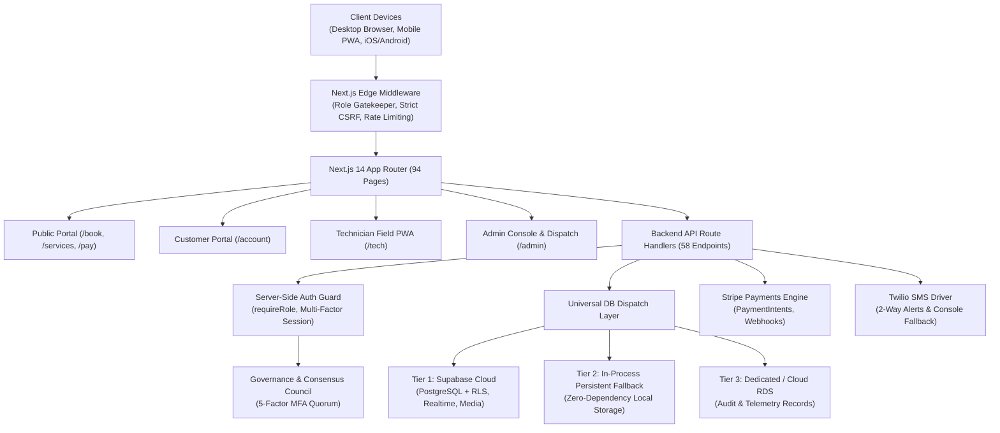

# ServicePro OS — System Architecture Document

## 1. System Overview
ServicePro OS is an enterprise-grade field service management and dispatch platform designed for service contractors (HVAC, plumbing, electrical, appliance repair). The platform provides 5 integrated user interfaces spanning **94 frontend pages** and **58 backend API route handlers**:

1. **Public Marketing & Booking Portal (`/` to `/book`)**: Fast, SEO-optimized booking funnel with address geocoding, service selection, calendar slot selection, photo uploads, 15-minute concurrency holds, and deposit checkout.
2. **Customer Self-Service Portal (`/account`)**: Appointment management, live technician tracking with route maps, invoice payments, service history, and support tickets.
3. **Technician Field PWA (`/tech`)**: Mobile-first field operations Progressive Web App for route navigation, checklists, on-site part usage, digital signature capture, and field invoicing.
4. **Admin & Dispatch Command Center (`/admin`)**: Operations management board (drag-and-drop Kanban, Day Calendar, fleet map), smart technician assignment scoring (0–100 pts), customer CRM, invoicing, payroll/revenue reporting, and infrastructure credential locker.
5. **System & Interactive Walkthrough (`/demo`, `/login`, `/register`)**: Unified authentication and interactive role simulation for prospective buyers and team onboarding.

---

## 2. Security Boundaries & Authorization Model
- **Route Gatekeeping**: Handled centrally in Next.js middleware and reinforced in individual route handlers via `src/lib/server/auth-guard.ts`.
- **Role Hierarchy & Aliasing**:
  - `owner` / `admin`: Full administrative access to dispatch operations, financial ledgers, payroll, and the infrastructure credential locker.
  - `technician`: Field worker with access restricted strictly to assigned jobs, route navigation, and van inventory.
  - `customer`: Property owner with access strictly bounded to their own appointments, invoices, and profile.
  - `anon`: Public booking visitors restricted to non-sensitive endpoints (`/api/services`, `/api/slots`, `/api/slots/hold`).
- **5-Factor Admin MFA & Consensus Quorum**:
  - High-risk operations (credential rotation, database resets, secret exports) require completing any 4 of 5 factors (Password, TOTP, Email OTP, WebAuthn Hardware Key, Master Recovery Key).
  - Destructive changes require Consensus Council approval.
- **CSRF Defense**: Enforces exact Origin / Referer validation across all mutation requests (`POST`, `PUT`, `PATCH`, `DELETE`).
- **Rate Limiting**: Sliding-window rate limiter enforcing tiered request quotas per IP address (20 req/min on payments/holds; 60 req/min general).
- **Cookie Security**: HttpOnly, SameSite=Strict cookies with dynamic `secure: true` in production environments. Zero client-side `document.cookie` leakage.

---

## 3. Data Tier & Provider Modularity
The platform features a multi-provider data architecture with seamless fallback:
1. **Tier 1: Supabase Cloud (PostgreSQL)**: Managed PostgreSQL, GoTrue Auth sessions, Realtime dispatch WebSockets, and encrypted S3 photo storage with Row Level Security.
2. **Tier 2: In-Process Persistent Local DB (`local-db-fallback.ts`)**: File-backed standalone engine enabling instant development, testing, and zero-cloud operation.
3. **Tier 3: Dedicated / Enterprise RDS**: Optional direct connection for high-throughput enterprise ledger and telemetry workloads.
