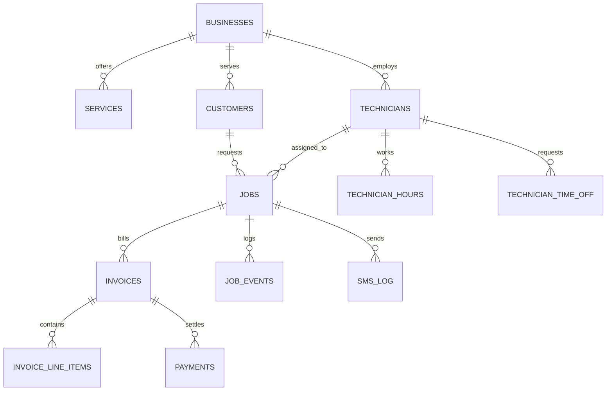

# ServicePro OS — Database Architecture & Schema Reference

## 1. Relational Database Overview
ServicePro OS uses PostgreSQL with Row Level Security (RLS). Schema definitions are maintained as sequential SQL migrations located in `supabase/migrations/` and consolidated into `supabase/combined_schema.sql`.

The data architecture operates on a multi-tier model:
- **Primary Tier (Cloud)**: Supabase PostgreSQL with real-time replication, WebSocket broadcast channels, and Row Level Security.
- **Standalone Fallback Tier**: In-process file-backed local database engine (`src/lib/server/local-db-fallback.ts`) guaranteeing zero-downtime development and offline capability when cloud credentials are not provisioned.



---

## 2. Core Relational Tables

### 1. `businesses`
Stores core business profile, tax rates, standard booking deposits, currency settings, and operating hours.
- Columns: `id (uuid, PK)`, `name`, `email`, `phone`, `address`, `tax_rate_percent`, `default_deposit_cents`, `created_at`.

### 2. `profiles`
Maps directly to Supabase Auth (`id uuid references auth.users`). Stores user roles (`owner`, `admin`, `technician`, `customer`) and profile metadata.
- Columns: `id (uuid, PK)`, `email`, `full_name`, `phone`, `role`, `technician_id (FK)`, `created_at`.

### 3. `services`
The business service catalog.
- Columns: `id (text, PK)`, `name`, `slug`, `category`, `description`, `base_price_cents`, `hourly_rate_cents`, `estimated_duration_minutes`, `required_skills (text[])`, `is_active`.

### 4. `technicians`
Field personnel directory with skill classifications, active fleet vehicles, and commission tiers.
- Columns: `id (text, PK)`, `first_name`, `last_name`, `phone`, `email`, `skills (text[])`, `service_zips (text[])`, `commission_rate_percent`, `is_active`.

### 5. `technician_hours`
Weekly recurring shift hours (Monday through Sunday) with start and end times.

### 6. `technician_time_off`
Scheduled technician vacations, sick leave, and unavailabilities used by the slot availability calculator.

### 7. `customers`
Customer directory storing service addresses, phone numbers, and Stripe customer IDs.
- Columns: `id (text, PK)`, `first_name`, `last_name`, `email`, `phone`, `address_line1`, `city`, `state`, `zip`, `stripe_customer_id`.

### 8. `jobs`
Central work order entity tracking statuses (`unassigned`, `assigned`, `on_the_way`, `in_progress`, `completed`, `cancelled`).
- Columns: `id (text, PK)`, `customer_id (FK)`, `technician_id (FK)`, `service_id (FK)`, `status`, `scheduled_date`, `time_window`, `diagnostic_notes`, `customer_signature_url`, `total_cents`, `deposit_paid_cents`.

### 9. `invoices`
Financial invoices generated upon work order completion.
- Columns: `id (text, PK)`, `job_id (FK)`, `customer_id (FK)`, `subtotal_cents`, `tax_cents`, `tip_cents`, `deposit_applied_cents`, `total_due_cents`, `status (unpaid, paid, refunded)`.

### 10. `invoice_line_items`
Granular line items for parts, labor hours, travel charges, and diagnostic fees.

### 11. `payments`
Transaction records storing Stripe PaymentIntent IDs, refund identifiers, and physical cash/check receipts.

### 12. `slot_holds`
Concurrency protection table placing an atomic 15-minute hold on a calendar window during booking intake.

### 13. `stripe_events`
Idempotency table storing processed Stripe webhook event IDs to prevent duplicate transaction execution.

### 14. `job_events`
Immutable append-only audit trail logging every status transition, dispatcher note, and technician arrival event.

### 15. `sms_log`
Chronological dispatch communication log recording all outgoing Twilio SMS alerts.

---

## 3. Row Level Security (RLS) Policies

All tables have RLS enabled with strict least-privilege policies:

| Table | Anonymous (`anon`) | Authenticated Customer | Field Technician | Owner / Admin |
|---|:---:|:---:|:---:|:---:|
| `services` | SELECT | SELECT | SELECT | ALL (CRUD) |
| `profiles` | DENIED | SELECT / UPDATE own profile | SELECT / UPDATE own profile | ALL |
| `technicians` | DENIED | DENIED | SELECT own record | ALL (CRUD) |
| `customers` | DENIED | SELECT / UPDATE own profile | SELECT assigned job contacts | ALL (CRUD) |
| `jobs` | DENIED | SELECT own jobs | SELECT / UPDATE assigned jobs | ALL (CRUD) |
| `invoices` | DENIED | SELECT own invoices | SELECT assigned job invoices | ALL (CRUD) |
| `payments` | DENIED | SELECT own receipts | SELECT / INSERT on-site receipts | ALL (CRUD) |
| `slot_holds` | DENIED (`service_role` only) | DENIED | DENIED | ALL |
| `stripe_events` | DENIED (`service_role` only) | DENIED | DENIED | ALL |
| `job_events` | DENIED | SELECT own job events | SELECT / INSERT assigned job events | ALL (CRUD) |

---

## 4. Standalone Fallback Database Architecture

For zero-cloud environments or rapid local development, ServicePro OS includes `src/lib/server/local-db-fallback.ts`:
- In-memory transactional data store that loads on startup.
- Persists state changes to disk in `.data/local-fallback-db.json`.
- Implements table queries, relational lookups, filter predicates, and atomic writes matching the Supabase query interface.
- Automatically activated when `NEXT_PUBLIC_SUPABASE_URL` is unconfigured, ensuring the application never crashes in offline modes.

---

## 5. Migration & Backup Runbook

### Applying Migrations to New Database
```bash
# Using Supabase CLI:
supabase db push

# Or execute combined schema directly via psql:
psql "$DATABASE_URL" -f supabase/combined_schema.sql
```

### Performing Database Backup
```bash
# Backup complete PostgreSQL schema and data:
pg_dump -Fc --no-acl --no-owner -h db.xyz.supabase.co -U postgres -d postgres > backup_servicepro_$(date +%Y%m%d).dump
```
