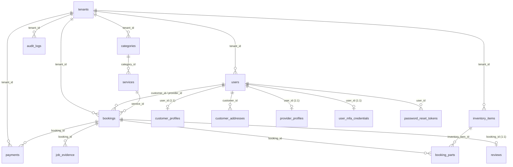

# DATABASE SCHEMA — PostgreSQL 16 + PostGIS Reference (19 Tables & 1 View)

**Document No.**: `11 / 25`  
**Version**: `1.0.0`  
**Last Updated**: November 15, 2026  
**Source Migrations**: [`01_initial_schema.sql`](../supabase/migrations/01_initial_schema.sql) (`326` lines), [`02_postgis_functions.sql`](../supabase/migrations/02_postgis_functions.sql) (`217` lines), [`03_security_rbac_and_rls.sql`](../supabase/migrations/03_security_rbac_and_rls.sql) (`300` lines) — **Total: `843` lines**

---

## 1. Verification Status Disclosure

- **Static SQL Validation**: **`VERIFIED`** (`npm run verify-env` via [`scripts/validate_migrations.cjs`](../scripts/validate_migrations.cjs) confirms balanced parentheses, quotes, and dollar-quoted PL/pgSQL blocks across all 3 migration files / `843` lines).
- **Live PostgreSQL 16 + PostGIS Execution**: **`NOT VERIFIED`** on the local audit host (`psql` and `docker` are not installed on the audit workstation).

---

## 2. Entity-Relationship Diagram (All 19 Tables)

---

## 3. Complete Inventory of All 19 Tables & 1 View

### Part A — 14 Core Tables in [`01_initial_schema.sql`](../supabase/migrations/01_initial_schema.sql)

1. **`public.tenants`** (Lines 17–32):
   - Columns: `id` (`UUID PK`), `slug` (`VARCHAR(64) UNIQUE NOT NULL`), `business_name` (`VARCHAR(128) NOT NULL`), `brand_logo_url`, `support_phone` (`DEFAULT ''`), `support_email` (`DEFAULT ''`), `default_currency` (`DEFAULT 'USD'`), `platform_take_rate_basis_points` (`DEFAULT 1500`), `day_vision_primary` (`DEFAULT '#6366F1'`), `day_vision_accent` (`DEFAULT '#7C3AED'`), `night_vision_bg` (`DEFAULT '#060B14'`), `is_active` (`DEFAULT TRUE`), `created_at`, `updated_at`.
2. **`public.users`** (Lines 37–51; role check updated in `03_security_rbac_and_rls.sql` lines 10–12):
   - Columns: `id` (`UUID PK`), `tenant_id` (`UUID NOT NULL FK -> tenants`), `phone` (`VARCHAR(32) UNIQUE NOT NULL`), `email` (`VARCHAR(128) UNIQUE`), `first_name` (`VARCHAR(64) NOT NULL`), `last_name` (`VARCHAR(64) NOT NULL`), `role` (`VARCHAR(32) NOT NULL` — constrained to `('CUSTOMER', 'TECHNICIAN', 'ADMIN', 'STAFF')` by migration `03`), `avatar_url`, `is_phone_verified`, `is_active`, `fcm_push_token`, `created_at`, `updated_at`.
   - Indexes: `idx_users_tenant_role`, `idx_users_phone`.
3. **`public.customer_profiles`** (Lines 59–68):
   - Columns: `id` (`UUID PK`), `user_id` (`UUID UNIQUE NOT NULL FK -> users`), `tier` (`DEFAULT 'PLATINUM VIP'`), `total_bookings` (`DEFAULT 0`), `lifetime_spend_cents` (`BIGINT DEFAULT 0`), `rating` (`NUMERIC(3,2) DEFAULT 5.00`), `stripe_customer_id` (`VARCHAR(64)`), `created_at`.
4. **`public.customer_addresses`** (Lines 70–84):
   - Columns: `id` (`UUID PK`), `customer_id` (`UUID NOT NULL FK -> users`), `label` (`DEFAULT 'Home'`), `street_line1` (`TEXT NOT NULL`), `street_line2`, `city`, `state`, `postal_code`, `country` (`DEFAULT 'US'`), `location` (`GEOGRAPHY(Point, 4326) NOT NULL`), `access_notes`, `is_default`, `created_at`.
   - Spatial Index: `idx_cust_addr_location USING GIST(location)`.
5. **`public.provider_profiles`** (Lines 91–116):
   - Columns: `id` (`UUID PK`), `user_id` (`UUID UNIQUE NOT NULL FK -> users`), `trade_license_number` (`VARCHAR(64) NOT NULL`), `trade_category` (`VARCHAR(64) NOT NULL`), `insurance_policy_number`, `insurance_carrier`, `insurance_expires_at`, `background_check_status` (`CHECK IN ('PENDING', 'CLEARED', 'REJECTED')`), `vehicle_make_model`, `vehicle_plate`, `is_verified`, `is_online`, `hourly_rate_cents` (`DEFAULT 9500`), `emergency_surge_rate_cents` (`DEFAULT 14500`), `service_radius_meters` (`DEFAULT 40000`), `current_location` (`GEOGRAPHY(Point, 4326)`), `last_ping_at`, `average_rating`, `reviews_count`, `completed_jobs_count`, `stripe_connect_account_id`, `is_payout_enabled`, `created_at`, `updated_at`.
   - Indexes: `idx_provider_location USING GIST(current_location)`, `idx_provider_online_trade`.
6. **`public.categories`** (Lines 124–136):
   - Columns: `id` (`UUID PK`), `tenant_id` (`UUID NOT NULL FK -> tenants`), `slug` (`VARCHAR(64) NOT NULL`), `title` (`VARCHAR(128) NOT NULL`), `short_title`, `priority_rank` (`INT NOT NULL DEFAULT 1`), `icon_name` (`VARCHAR(64) NOT NULL`), `image_url` (`TEXT NOT NULL`), `is_active` (`DEFAULT TRUE`), `created_at`, `UNIQUE(tenant_id, slug)`.
7. **`public.services`** (Lines 143–154):
   - Columns: `id` (`UUID PK`), `category_id` (`UUID NOT NULL FK -> categories`), `name` (`VARCHAR(128) NOT NULL`), `description` (`TEXT NOT NULL`), `base_price_cents` (`BIGINT NOT NULL`), `estimated_duration_minutes` (`INT NOT NULL DEFAULT 60`), `is_popular` (`DEFAULT FALSE`), `is_active` (`DEFAULT TRUE`), `created_at`, `updated_at`.
8. **`public.bookings`** (Lines 162–207):
   - Columns: `id` (`UUID PK`), `tenant_id` (`UUID NOT NULL FK -> tenants`), `booking_reference` (`VARCHAR(16) UNIQUE NOT NULL`), `customer_id` (`UUID NOT NULL FK -> users`), `provider_id` (`UUID FK -> users`), `service_id` (`UUID NOT NULL FK -> services`), `status` (`CHECK IN ('REQUESTED', 'BROADCASTING', 'ASSIGNED', 'EN_ROUTE', 'ARRIVED', 'IN_PROGRESS', 'COMPLETED', 'CANCELLED', 'DISPUTED')`), `is_emergency`, `emergency_surcharge_cents`, `service_location` (`GEOGRAPHY(Point, 4326) NOT NULL`), `address_text` (`TEXT NOT NULL`), `access_notes`, `problem_description`, `scheduled_start` (`TIMESTAMPTZ NOT NULL`), `actual_arrival_at`, `work_started_at`, `work_completed_at`, `labor_cost_cents` (`BIGINT NOT NULL`), `diagnostic_fee_cents` (`DEFAULT 2000`), `parts_total_cents`, `tax_amount_cents`, `platform_fee_cents` (`BIGINT NOT NULL`), `net_payout_cents` (`BIGINT NOT NULL`), `total_authorized_cents` (`BIGINT NOT NULL`), `escrow_status` (`CHECK IN ('HELD_IN_ESCROW', 'RELEASED_TO_PROVIDER', 'REFUNDED_TO_CUSTOMER', 'FROZEN_FOR_DISPUTE')`), `safety_pin` (`VARCHAR(6) NOT NULL`), `payment_intent_id`, `created_at`, `updated_at`.
   - Indexes: `idx_bookings_tenant_status`, `idx_bookings_location USING GIST(service_location)`, `idx_bookings_customer`, `idx_bookings_provider`.
9. **`public.payments`** (Lines 217–244):
   - Columns: `id` (`UUID PK`), `tenant_id` (`UUID NOT NULL FK -> tenants`), `booking_id` (`UUID FK -> bookings`), `customer_id` (`UUID NOT NULL FK -> users`), `provider_id` (`UUID FK -> users`), `amount_cents` (`BIGINT NOT NULL`), `currency` (`DEFAULT 'USD'`), `status` (`CHECK IN ('PENDING', 'AUTHORIZED', 'HELD_IN_ESCROW', 'CAPTURED', 'RELEASED_TO_PROVIDER', 'REFUNDED', 'FAILED', 'DISPUTED')`), `gateway` (`DEFAULT 'STRIPE'`), `gateway_payment_intent_id`, `gateway_charge_id`, `receipt_url`, `refund_amount_cents`, `fee_amount_cents`, `metadata` (`JSONB`), `created_at`, `updated_at`.
10. **`public.job_evidence`** (Lines 253–261):
    - Columns: `id` (`UUID PK`), `booking_id` (`UUID NOT NULL FK -> bookings`), `evidence_type` (`CHECK IN ('BEFORE', 'AFTER', 'PARTS', 'SIGNATURE')`), `media_url` (`TEXT NOT NULL`), `captured_by_user_id` (`UUID NOT NULL FK -> users`), `metadata` (`JSONB`), `captured_at`.
11. **`public.inventory_items`** (Lines 268–278):
    - Columns: `id` (`UUID PK`), `tenant_id` (`UUID NOT NULL FK -> tenants`), `sku` (`VARCHAR(64) UNIQUE NOT NULL`), `name` (`VARCHAR(128) NOT NULL`), `category` (`VARCHAR(64) NOT NULL`), `unit_cost_cents` (`BIGINT NOT NULL`), `retail_price_cents` (`BIGINT NOT NULL`), `stock_quantity` (`DEFAULT 0`), `created_at`.
12. **`public.booking_parts`** (Lines 280–289):
    - Columns: `id` (`UUID PK`), `booking_id` (`UUID NOT NULL FK -> bookings`), `inventory_item_id` (`UUID FK -> inventory_items`), `part_name` (`VARCHAR(128) NOT NULL`), `quantity` (`DEFAULT 1`), `unit_price_cents` (`BIGINT NOT NULL`), `is_approved_by_customer` (`DEFAULT TRUE`), `approved_at`.
13. **`public.reviews`** (Lines 294–305):
    - Columns: `id` (`UUID PK`), `booking_id` (`UUID UNIQUE NOT NULL FK -> bookings`), `customer_id` (`UUID NOT NULL FK -> users`), `provider_id` (`UUID NOT NULL FK -> users`), `rating` (`INT CHECK BETWEEN 1 AND 5`), `comment`, `tip_amount_cents` (`DEFAULT 0`), `is_verified_purchase`, `is_moderated`, `created_at`.
14. **`public.audit_logs`** (Lines 312–324):
    - Columns: `id` (`UUID PK`), `tenant_id` (`UUID NOT NULL FK -> tenants`), `actor_id` (`UUID FK -> users`), `actor_email`, `ip_address` (`INET`), `action` (`VARCHAR(64) NOT NULL`), `entity_type` (`VARCHAR(64) NOT NULL`), `entity_id`, `payload` (`JSONB`), `sha256_hash`, `created_at`.

### Part B — 5 Security Tables & 1 View in [`03_security_rbac_and_rls.sql`](../supabase/migrations/03_security_rbac_and_rls.sql)

15. **`public.user_mfa_credentials`** (Lines 17–29):
    - Columns: `id` (`UUID PK`), `user_id` (`UUID UNIQUE NOT NULL FK -> users`), `totp_secret_encrypted` (`TEXT NOT NULL`), `recovery_code_hashes` (`TEXT[] NOT NULL`), `is_mfa_enabled`, `failed_mfa_attempts`, `locked_until`, `last_verified_at`, `created_at`, `updated_at`.
16. **`public.security_audit_logs`** (Lines 36–48):
    - Columns: `id` (`UUID PK`), `actor_email` (`VARCHAR(128) NOT NULL`), `role` (`VARCHAR(32) NOT NULL`), `event_type` (`VARCHAR(64) NOT NULL`), `severity` (`CHECK IN ('INFO', 'WARNING', 'CRITICAL')`), `ip_address` (`DEFAULT '0.0.0.0'`), `user_agent`, `details` (`TEXT NOT NULL`), `metadata` (`JSONB`), `sha256_signature`, `created_at`.
    - Trigger: `trg_security_audit_immutable` (`BEFORE UPDATE OR DELETE`) calls `prevent_audit_log_tampering()` to block record modification or deletion.
17. **`public.auth_rate_limits`** (Lines 69–75):
    - Columns: `key` (`VARCHAR(128) PK`), `attempt_count` (`DEFAULT 1`), `first_attempt_at`, `last_attempt_at`, `locked_until`.
18. **`public.password_reset_tokens`** (Lines 82–91):
    - Columns: `id` (`UUID PK`), `user_id` (`UUID NOT NULL FK -> users`), `token_hash` (`VARCHAR(64) NOT NULL`), `expires_at` (`TIMESTAMPTZ NOT NULL`), `is_used`, `used_at`, `ip_address`, `created_at`.
19. **`public.auth_otps`** (Lines 99–111):
    - Columns: `id` (`UUID PK`), `destination` (`VARCHAR(128) NOT NULL`), `otp_hash` (`VARCHAR(64) NOT NULL`), `otp_type` (`CHECK IN ('LOGIN', 'PHONE_VERIFY', 'MFA', 'PASSWORD_RESET')`), `attempt_count`, `max_attempts` (`DEFAULT 3`), `expires_at`, `is_verified`, `verified_at`, `ip_address`, `created_at`.
20. **View `public.service_categories`** (Line 169):
    - `CREATE OR REPLACE VIEW service_categories WITH (security_invoker = true) AS SELECT * FROM categories;`
