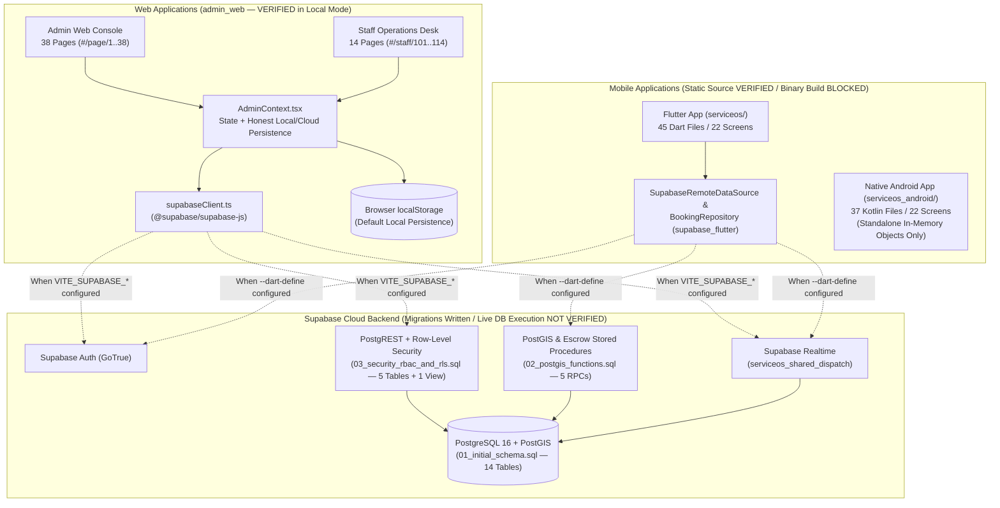

# SYSTEM ARCHITECTURE — Full-Stack Topology & Persistence Boundaries

**Document No.**: `06 / 25`  
**Version**: `1.0.0`  
**Last Updated**: November 15, 2026

---

## 1. Full-Stack Topology Diagram

---

## 2. Persistence Architecture & Honest Toast Reporting

A critical architectural requirement is that **no operation may falsely report a successful cloud save when only local browser state changed**.

In [`admin_web/src/context/AdminContext.tsx`](../admin_web/src/context/AdminContext.tsx), entity mutations (`addCustomer`, `updateCustomer`, `addTechnician`, `updateTechnician`, `addCategory`, `updateCategory`, `addService`, `updateService`, `deleteService`, `createBooking`, `updateBookingStatus`, `verifyBooking`) implement a strict three-branch notification contract:

1. **Branch 1 — Supabase Unconfigured (`supabaseService.isConfigured() === false`)**:
   - Data is written to `localStorage`.
   - Toast message explicitly states: `"...saved to local browser storage."` (never claims cloud persistence).
   - **Important Buyer Disclosure**: Data saved in `localStorage` resides only inside the current browser profile on that single device and is not shared with other users or mobile devices.
2. **Branch 2 — Supabase Configured & Remote Write Succeeds (`synced === true`)**:
   - Data is written to `localStorage` and awaited against `supabaseService.save*()`.
   - Only after `supabaseService.save*()` resolves `true` does the app toast: `"...created and synced to cloud database!"`.
3. **Branch 3 — Supabase Configured & Remote Write Fails (`synced === false` or rejected)**:
   - The app immediately fires a yellow warning toast: `"...saved to local browser storage only; cloud database sync failed."`
