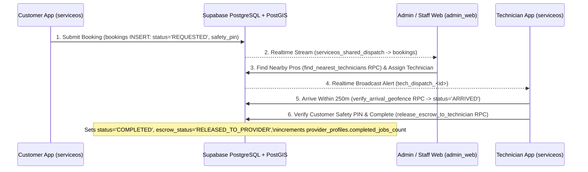

# WORKFLOW DOCUMENTATION — End-to-End Operational Lifecycles

**Document No.**: `20 / 25`  
**Version**: `1.0.0`  
**Last Updated**: November 15, 2026

---

## 1. End-to-End Booking, Dispatch, Geofence & Escrow Workflow

---

## 2. Verification Status of Each Workflow Step

| Workflow Step | Local Mode (`admin_web` / Simulators) | Cloud Mode (`Supabase + PostGIS + Flutter`) | Live Third-Party Gateways (`Stripe` / `Twilio`) |
| :--- | :--- | :--- | :--- |
| **1. First-Boot Admin Setup & Login** | **`VERIFIED`** ([`LoginPage.tsx`](../admin_web/src/pages/auth/LoginPage.tsx) PBKDF2 in [`passwordPolicy.ts`](../admin_web/src/security/passwordPolicy.ts) + [`AdminContext.tsx`](../admin_web/src/context/AdminContext.tsx)) | **Code Wired (`supabase.auth.signUp` / `signIn`) — Live DB `NOT VERIFIED`** | N/A |
| **2. Service Category & Item Creation** | **`VERIFIED`** ([`Page14ServiceCategories.tsx`](../admin_web/src/pages/module3/Page14ServiceCategories.tsx), [`Page13AllServices.tsx`](../admin_web/src/pages/module3/Page13AllServices.tsx), [`Page15AddEditService.tsx`](../admin_web/src/pages/module3/Page15AddEditService.tsx) -> `localStorage`) | **Code Wired (`saveCategory`, `saveService`) — Live DB `NOT VERIFIED`** (Requires minor payload alignment noted in [`KNOWN_ISSUES_AND_LIMITATIONS.md`](KNOWN_ISSUES_AND_LIMITATIONS.md)) | N/A |
| **3. Booking Creation & Technician Assignment** | **`VERIFIED`** ([`Page06AllBookings.tsx`](../admin_web/src/pages/module2/Page06AllBookings.tsx), [`Page07NewBookingRequests.tsx`](../admin_web/src/pages/module2/Page07NewBookingRequests.tsx), [`ManualDispatchModal.tsx`](../admin_web/src/components/modals/ManualDispatchModal.tsx)) | **Code Wired (`saveBooking`, `find_nearest_technicians`) — Live DB `NOT VERIFIED`** | **Stripe Pre-Auth Hold `NOT IMPLEMENTED`** |
| **4. 250m Geofence Arrival Check-In** | **`VERIFIED` (UI Simulator in [`MobileSimulatorModal.tsx`](../admin_web/src/components/commercial/MobileSimulatorModal.tsx))** | **PL/pgSQL RPC `verify_arrival_geofence` Written in [`02_postgis_functions.sql`](../supabase/migrations/02_postgis_functions.sql) — Live DB `NOT VERIFIED`** | **Twilio Arrival SMS `NOT IMPLEMENTED`** |
| **5. Job Completion & 85%/15% Escrow Release** | **`VERIFIED`** (`verifyBooking` in [`AdminContext.tsx`](../admin_web/src/context/AdminContext.tsx) & [`DispatchSimulatorModal.tsx`](../admin_web/src/components/commercial/DispatchSimulatorModal.tsx)) | **PL/pgSQL RPC `release_escrow_to_technician` Written in [`02_postgis_functions.sql`](../supabase/migrations/02_postgis_functions.sql) — Live DB `NOT VERIFIED`** | **Stripe Connect Transfer `NOT IMPLEMENTED`** |
